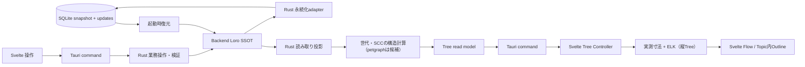
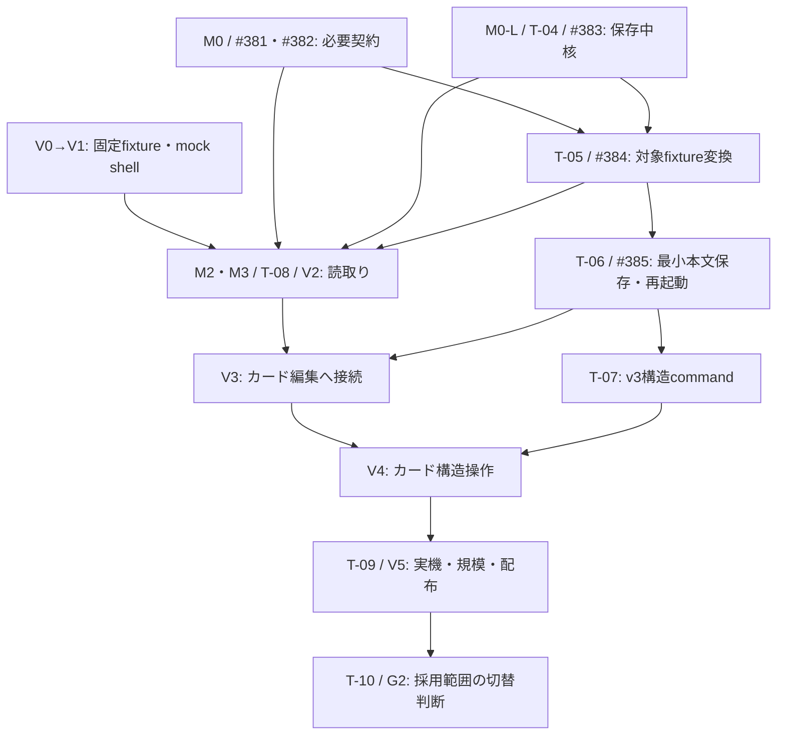

# Tauri移行計画とTreeの責務分担

作成日: 2026-10-11 状態:
Tauri/Loro移行の全体計画。2026-10-30に縦系譜UIの工程・依存・受入を接合した。製品実装・移行・性能の完了記録ではない。
調査基点: ローカルHEAD
`9f3dcaf`。開始時点の未コミット変更を含む作業ツリーを参照した。main反映や移行実装の完了を示す文書ではない。
Loro追補の照合基点: `poc/loro-undo` HEAD `faa8c16`、ローカルmain
`8acc2af`。詳細な根拠・障壁・先行PoC仕様は[Loro Backend移行調査](loro-backend-migration-research.md)に記録する。
接合基点: `v3` /
`671ab70c26e963248de50f638d8c06b1a493a23f`。製品モデルは[v3決定事項](v3-model-decisions.md)、
実行順・Issue/gateは[移行バックログ](tauri-loro-transition-backlog.md)、縦Tree固有のUI契約は[縦ツリー実装計画](vertical-tree-implementation-plan.md)に分ける。
以下の現行コード/旧データに関する記述を、v3で同じentityや操作モデルを再実装する指示としない。
**Tauri 2 + Svelte 5を維持し、文書・Block・Relationの正本をBackend
Loroとする。SQLiteにはLoroのsnapshot＋差分と、独立したローカルUI設定を保存する。ControllerはBackend
APIを通してアクセスする。**

## 1. 方針

**Tauri 2 + Svelte
5を維持し、BackendのLoroを保存対象データのSSOTとする。SQLiteにはLoroのsnapshotと差分Updateを永続化する。ControllerはBackend
APIを通してアクセスする。**
Rustのserviceが業務上の検証・Loro操作・Relationの構造計算を所有し、フロントは寸法・座標・表示・操作を担当する。
petgraphはRust構造計算の候補であり必須採用ではない。UI
draft・選択・focusやLoro内部型を保存モデル/IPCへ混ぜない。
SQLiteの検索索引等を追加する場合も、Loroから再生成できる派生データとする。

製品モデルは[v3決定事項](v3-model-decisions.md)を正本とする。 単一workspaceに一つのBackend
LoroDoc、親を持たないBlock＋子孫＝Topic、root Block＝タイトル、UUIDv7の論理ID、
代表Block＋本文を表示する参照項目、workspace共通Undo/Redoを採用する。旧Work/Occurrence/Branchを機械的に対応付けない。
保存技術PoCと製品モデル・旧情報保全の受入は分ける。
名前と到達先は[名前契約](v3-naming-and-search-contract.md)、初回必須/後続と完成条件は[初回提供範囲 F01〜F16](v3-first-release-scope.md)に固定する。
機能表の策定は初回完成・配布・G2/G3承認を意味しない。 2026-10-30にRelationのBlock
endpoint/Topic投影、filter前の世代/SCC、foldのSQLite保存、
Undoの操作単位/再起動終了/復帰動作を採用した。正本と変更コストは[v3決定事項](v3-model-decisions.md)を参照する。

**v3の縦系譜UIはSvelte Flowを表示・操作基盤とし、ELK
Layeredを配置の第一候補にする。派生元を上、派生先を下に置く。** 一つのTopicを一つのcustom
nodeとし、内部のLoroTreeはカード内アウトライン、外部の系譜はRelationとする。
ユーザー確認（2026-10-30）: v2のGlobal
Lineage表示は、[縦ツリーモック](../../spikes/vertical-tree-mock/index.html)を方向性とするv3表示へ置き換える。
旧「SVG/D3を先行採用し、Svelte Flowは任意評価」は、この縦Treeの実装方針としては置き換える。
既存SVG/D3はChronology等の時間投影と比較fixtureに残せる。最初の保存sliceは縦Treeの完成を待たない。

Petgraphはグラフのデータ構造とアルゴリズムを提供するライブラリであり、保存、Radiora固有の関係型、UI状態、座標配置をまとめて所有するものではない。[Petgraph公式](https://docs.rs/petgraph/latest/petgraph/)
ELK.js/Dagreは座標計算を担当し、ノードの描画や選択・編集操作は別途必要になる。[ELK.js公式](https://github.com/kieler/elkjs)、[Dagre公式](https://github.com/dagrejs/dagre)

今回の対象は設計・計画の文書化。依存追加、Tauri雛形、DB変換、Rust移植は行わない。

## 2. 移行理由と前提

Denoは2026-10-09の公式発表で、runtimeのバグ修正・セキュリティ更新を月次であと1年間提供し、その後は自社での開発を終了すると発表した。OSSとしての継続可能性と、Deno社による保守終了は区別する。Deno
Desktop固有のサポート期間はこの発表から断定できない。[Deno公式発表](https://deno.com/blog/cloudflare)

このため、Deno
Desktopへの新たな依存を増やさず、配布アプリのruntimeをTauriへ移す。移行期間の旧版と検証用Deno
CLIは維持できるが、最終配布アプリのDeno同梱は終了する方針とする。残る開発用Denoタスクも後述のM5で移行する。

TauriはシステムWebViewを利用するため、現在のCEFと同じ描画エンジンではない。WindowsはWebView2、LinuxはWebKitGTKを使う。軽量化や性能改善は期待だけで採用根拠にせず、同じデータと操作で実機比較する。[Tauriアーキテクチャ](https://v2.tauri.app/concept/architecture/)

## 3. 現行コードの移行地図

| 現在の責務                   | 確認した実装                                                                                                                                                                                        | 移行方針                                                                             |
| ---------------------------- | --------------------------------------------------------------------------------------------------------------------------------------------------------------------------------------------------- | ------------------------------------------------------------------------------------ |
| 起動・Window・HTTP・終了処理 | [main.ts](../../src/main.ts)、[desktop bindings](../../src/desktop/register_bindings.ts)                                                                                                            | Tauriの起動とcommandsへ。composition rootには配線・委譲を置く                        |
| フロントの呼出し             | [rpc_adapter.ts](../../src/ui/rpc_adapter.ts)、[bindings.ts](../../src/shared/bindings.ts)                                                                                                          | Controllerのportを維持し、HTTP transportをTauri invokeのadapterへ置換                |
| Tree対象・Relation/filter    | [branch_service.ts](../../src/services/branch_service.ts)、[global_lineage_filter.ts](../../src/services/global_lineage_filter.ts)、[implicit_relation.ts](../../src/services/implicit_relation.ts) | v3のTopic/Block/Relationへ読取り投影を再設計。LoroTreeの親子から暗黙FROMを生成しない |
| 世代・循環                   | [tree_lineage_projection.ts](../../src/ui/tree_lineage_projection.ts)、[tree_lineage_cycles.ts](../../src/ui/tree_lineage_cycles.ts)                                                                | Rustの投影へ。Knot membershipを維持し、FROM世代方向の変更は新旧fixtureで明示         |
| 表示順のための隣接走査       | [tree_lane_order.ts](../../src/ui/tree_lane_order.ts)                                                                                                                                               | 旧fixtureの安定順を参照。カード横順へ旧lane算法を必須移植しない                      |
| 寸法・座標・LOD              | [tree_layout.ts](../../src/ui/tree_layout.ts)                                                                                                                                                       | 縦Treeは実測カード寸法→ELK。時間投影は既存layoutを基準とし、LOD高度化は後続          |
| 描画・camera・pointer・focus | [PhylogeneticTree.svelte](../../src/ui/PhylogeneticTree.svelte)、[tree_pointer_adapter.ts](../../src/ui/tree_pointer_adapter.ts)、[tree_camera.ts](../../src/ui/tree_camera.ts)                     | 縦TreeはSvelte Flowへ。D3 cameraを二重所有せず、editor/focus/画面復帰の契約を適合    |
| 歴史年代の年表               | [HistoricalTimeline.svelte](../../src/ui/HistoricalTimeline.svelte)、[historical_timeline_layout.ts](../../src/ui/historical_timeline_layout.ts)                                                    | 通常Treeとは別の時間投影として維持                                                   |
| Treeの設定・取得・公開       | [tree_controller.svelte.ts](../../src/ui/tree_controller.svelte.ts)                                                                                                                                 | 所有と要求失効を維持。非同期レイアウトにも公開条件を適用                             |
| DB・保存復元                 | [storage_bootstrap.ts](../../src/storage/storage_bootstrap.ts)、[sqlite_store.ts](../../src/storage/sqlite_store.ts)、[sqlite_records.ts](../../src/storage/sqlite_records.ts)                      | record形式を新Loro docへ変換し、SQLiteをsnapshot＋差分の保存先へ変更。旧DBは保全する |
| 配布・更新・監査             | `scripts/desktop_*`、[release workflow](../../.github/workflows/release.yml)、[deno.json](../../deno.json)                                                                                          | Tauriのdev/build/bundleへ。更新・署名・installer・監査は個別検証                     |

既存の[UI所有契約](ui-state-ownership.md)、[Tree所有契約](tree-state-ownership.md)、[画面復帰契約](outline-screen-navigation.md)、[永続化契約](storage-persistence-contracts.md)の振る舞い・データ保護を基準とする。SQLiteの継続と、recordを正本とする現在の保存方式の維持は別。main側のADR
0003の限定導入案との相違は追補§6.5で扱う。

## 4. 目標のModuleとInterface

図は最終構成。現行TypeScriptのバックエンドがTauriに自動移植されることを意味しない。

### Rustが所有すること

- Loro doc、操作単位の検証・直列化、SQLiteへのsnapshot/Update保存・復元。Loro commitとSQLite
  transactionを区別する。
- 保存対象Block・本文・階層・参照項目・Relation・削除記録と、保存成功後のread model公開。
- Topic所属と元Relation
  endpointの読取り投影、表示filter適用前の有効graphに対する世代/SCC。filterは表示だけに適用し、旧配置からの暗黙関係を直訳しない。
- 意味グラフの隣接・到達・SCCなどの構造計算と、Radioraのルールによる世代・結び目の決定。
- 計算に使ったデータ版と、投影条件を識別できる値。
- 本文foldとカード開閉はLoroと別のSQLite UI設定領域へ保存し、設定API/adapterが永続化を所有する。
  live設定・一時展開・設定保存状態は対応UI Controllerが所有し、文書writerや共通Undoと混ぜない。

petgraphを採用しても内部indexを永続IDやIPCへ公開しない。論理Block/Relation
IDとの対応はRust内に閉じ込める。
既存Tarjanは反復実装だがpetgraphのTarjanは再帰実装のため、深い鎖・巨大SCCの耐性を同じfixtureで確認する。
最初は要求ごとのgraph構築でよく、常駐graph・差分cacheは計測後に判断する。

LoroTreeの文書内階層、Relationの系譜、旧Revisionの履歴は別構造。意味グラフの循環を保存時に削除/反転しない。

### フロントが所有すること

- 画面寸法、フォントとラベル寸法、world座標、edgeの描画経路。
- Svelte Flowのviewport・hover・選択表示、描画量の制御。高度なLOD/clusterを初回の前提にしない。
- featureのdraft、投影/filterの設定、最新要求の公開、画面復帰・focus/caret。

Rust側の構造的SCCと、ズーム時に画面上で重なるノードのclusterは別物。後者をPetgraphへの移植対象にしない。

### commandを通すInterfaceの契約

最小保存sliceのDTOはM1/M4で必要な範囲だけ固定し、Tree全体の完成を待たない。 縦TreeではTopic
root/表示Block/本文owner ID、元Relation IDとendpoint、表示用endpoint、世代、Knot membership、
投影条件と保存済み版をread
modelへ含める。Relationは全Blockを対象とし、元endpointを維持してTopicへ投影する採用契約をM0/V0でDTO/fixture化する。表示filterと世代/SCC計算を分ける。
旧`listGlobalLineage`のWork/Occurrence DTOをv3の最終契約へ固定しない。 ELK
graphやpetgraph型をIPCへ漏らさず、`Map`/`Set`はJSONで運べる配列・recordへ変換する。

Rust入力はSerdeによる形の検査に加え、ID・関係型・参照先・操作権限・業務不変条件を検証する。フロントも受信DTOをruntime
validationする。TypeScriptの型注釈だけで通信の正しさを保証しない。日時、数値範囲、欠損・null、error
code/messageの対応を契約テストで固定する。

UI要求の取消は結果の公開を失効させる。完了したDB書込みを巻き戻さない。Rustの重い計算・同期DB処理はWebViewやcommand処理を塞がない実行方法を選び、DBのwriterを一箇所にする。

## 5. レイアウトと描画ライブラリの選択

| 候補               | 任せる範囲                                | v3での扱い                                                                 |
| ------------------ | ----------------------------------------- | -------------------------------------------------------------------------- |
| `@xyflow/svelte`   | Topicカード・edge・pan/zoom・keyboard基盤 | 縦Treeの表示/操作基盤。本文とUndoは既存Controller/Backendへ                |
| `elkjs`            | Layeredの座標・edge route                 | 縦Treeの配置の第一候補。可変寸法・Worker・公開失効・配布assetをV1/M3で検証 |
| `@dagrejs/dagre`   | 単純な階層配置                            | ELK不適合時だけ比較。同時採用・engine切替設定を先行追加しない              |
| 現行layout・SVG/D3 | 時刻軸・既存の意味/性能fixture            | Chronology等の時間投影と比較基準。縦Tree完成前の必須実装経路にはしない     |

能力の一次資料は[移行調査](tauri-migration-research.md)と[縦Treeライブラリ調査](vertical-tree-library-research.md)、
編集・寸法・Knot・非同期公開の詳細は[縦ツリー実装計画](vertical-tree-implementation-plan.md)
§3〜6を参照する。 Svelte Flowはlayout
engineではなく、ELKもRelationの意味/世代/本文保存のownerではない。

**Chronologyと歴史年代の時刻軸はELKで上書きしない。**
縦TreeはFROMの保存方向を維持し、表示用endpointと世代計算を派生元→派生先へ正規化する。
旧「保存sourceがG0」の世代テストとの同値移植ではない。この仕様変更をM0/V0のfixtureへ記録する。
循環memberだけをKnot領域へ分け、残るDAGを最深親+1で計算する。SCC縮約やELKのrankを同じ意味として代用しない。

実測したカードwidth/heightからELKを実行し、座標とedge routeを同じ要求で公開する。
pan/通常zoomでは再配置せず、入力・foldによる寸法変化だけをまとめる。古いlayoutの成功/失敗/finallyは最新stateへ書かない。
編集中のBlock DOM・IME・caret・画面内anchorを維持し、更新ごとのfitViewを行わない。
自由配置・handle接続編集・高度なLODは初回対象外。Svelte Flowの既定削除を業務commandの代用にしない。

## 6. バックエンド移行の選択

**推奨は、保存・業務上の不変条件・大きな構造計算をRustへ移し、Svelteの状態所有と再利用できる純粋なTypeScript処理を残す段階移行。**
既存serviceの全メソッドをRustへ直訳する計画にはしない。「グラフ計算だけRust」と「Deno
runtimeを配布から外す」は別の仕事である。

| 経路                                     | 利点                                | 費用・判断                                                                                          |
| ---------------------------------------- | ----------------------------------- | --------------------------------------------------------------------------------------------------- |
| Rustへfeature単位で再実装                | 最終runtimeがTauri/Rustに収まる     | 振る舞い・データ・保存契約を保持し、保存/query/計算の実装は変更する。独立したTS表示処理は残す。推奨 |
| 一時的なNode sidecarでTSバックエンド維持 | service資産を早期再利用できる可能性 | Deno I/O・JSR・起動/終了・IPC・配布の互換確認が必要。納期上必要な場合だけM0で選ぶ                   |
| Deno sidecarを継続                       | 既存バックエンドを流用しやすい      | Deno依存終了の目的を達成しない。最終構成には採用しない                                              |

Rust移植が機能の早期提供に間に合わない場合はNode
sidecarを別案として見積もる。今回はsidecar実装や互換shimを先行作成しない。移行途中のTauri版は対応済みの操作だけを検証し、未対応commandを成功扱いしない。

### 6.1 保持する振る舞いと置き換える実装（2026-10-11追補）

SQLiteを維持しても、現在の保存方法まで維持する必要はない。移行の単位はファイルやserviceクラスではなく、ユーザー操作と、その操作が守る不変条件とする。

現行 `SqliteGraphStore` は `MemoryGraphStore` を継承するが、すべての保存が全state diffではない。
`SqlitePersistence.mutateTargeted` は局所更新とrollbackを行い、構造変更等は全state
export/diff/restore経路へ分岐する。[保存境界](../../src/storage/sqlite_persistence.ts#L60-L90)
現在の `listOutline`
は項目・Knotを読み、再帰配置等を投影する処理であり、Knotを書き戻さない。[Outline操作](../../src/services/occurrence_operations.ts#L39-L48)
2026-10-11時点の説明を現在の退行や移植要件にしない。これらの実行手順は互換性の対象から外し、表示結果・保存結果・失敗時の保護を対象にする。[性能監査](../performance-audit-2026-10-08.md)は別HEADでの過去の単体測定であり、今回の性能測定ではない。

| 対象                                               | 保持するもの                                          | 再利用・置換・保留の判断                                                                  |
| -------------------------------------------------- | ----------------------------------------------------- | ----------------------------------------------------------------------------------------- |
| 旧Work/Branch/WorkingCopy/Occurrence/Revision/Link | 既存情報・参照・共有・履歴・配置固有の子構造          | #384の写像/実体化/archiveへ。旧entityの全再実装はしない                                   |
| 本文保存・復元・破棄                               | draft保護、失敗通知、保存の整合性、代表本文の参照表示 | Rustの操作単位で差分耐久化。全state clone/diff/rollbackを通常保存へ持ち込まない           |
| 階層変更・削除・復元                               | 順序・ID・対象集合と取り消しの意味                    | v3境界操作/削除契約を適用。子の昇格削除を通常削除へ混ぜない                               |
| Outline/Treeの読取り投影                           | filter、選択表示例外、参照と階層の分離                | read時にDBを書かず、Topic所属/Relation・Knotを派生する                                    |
| Svelte Controller/Workspace                        | state owner、要求世代、draft、guard、選択、画面復帰   | 再利用。ただし全feature一律reloadの配線は変更する                                         |
| Markdown表示・export等の純粋なTS処理               | 書式、参照表現、出力形式                              | I/Oと切り離せる処理はTSで再利用する候補。保存の権威をフロントへ移さない                   |
| 検索・逆参照・タグ                                 | 保存データ、参照の正しさ、必要な検索入口              | 全文/全履歴の反復走査を移さず、取得範囲・更新単位を再設計。ランキング高度化は別の採否判断 |
| Tree世代・循環・隣接                               | 投影の意味と安定順序                                  | Petgraph等へ構造計算を委任。入力変更時の計算とcamera操作を分離                            |
| Outlineの可視行・editor表示                        | 行順、IME、focus/caret、編集継続                      | 多rootの反復find・深い再帰を置換。目標可視行数が大きければviewport仮想化を設計            |
| Query/関係サジェスト/版比較/専用一覧等             | 保存済み定義・feedback・履歴・対象ID等                | 初回の画面/新規操作は後続とし、初回範囲表§3の読出し/export/backup最低保護を必須にする     |
| Deno Desktop用HTTP/HMR/CEF配布                     | 必要な起動・診断・配布能力                            | Tauri方式へ置換後に旧実装を撤去。ログ/エラー報告の機能は維持                              |
| Memory/JSONのstore実装                             | テストfixture、JSONバックアップ/復元の互換性          | Rustへ三種類の同形storeを再作成しない。製品のJSON通常保存モードを終えるかは別決定         |

「機能を後回しにする」と「その保存データを捨てる」は別の決定とする。画面を提供しない機能のデータも、保存・export・restoreで往復できることを証明する。未知データを黙って落とす全体復元/再保存は行わない。

### 6.2 保存・読取り・UI更新を操作別に設計する

通常の保存は「対象と依存先を読む・検証 → Loroへ操作を適用・commit → 保存済みVersion
Vector（VV）から差分export → 差分と保存済みVVを一つのSQLite transactionで保存 → 保存成功後にread
modelを公開」とする。
**通常更新の成功は差分UpdateのSQLite保存成功まで。全snapshotの生成・保存を毎回待たない。**
初回導入・明示checkpointはsnapshot保存transactionの成功までをその処理の成功条件とする。 LoroにはACID
rollback/isolationがないため、SQLite失敗でLoroまで戻ったと扱わない。保存失敗時の保護と再試行は§6.5の先行検証で固定する。DB全体のcloneを通常保存の前提にしない。

| 操作                         | 保存と更新の範囲                                                                                            | 避ける処理                                                          |
| ---------------------------- | ----------------------------------------------------------------------------------------------------------- | ------------------------------------------------------------------- |
| 本文1件保存                  | 対象Block本文。表示名・参照・タグ・検索等を失効し、代表の参照項目へ反映。寸法変化はUIで再測定               | 無関係の全履歴/graph clone、本文だけの変更による世代再構築          |
| fold1件                      | workspace/Block IDでSQLiteのUI設定だけ保存。Outline/カード/各paneで共有し、paneの一時展開とカード開閉は分離 | foldをLoro階層/共通Undoへ入れること、意味グラフや全bookmarkの再取得 |
| 階層変更・切り出し・削除復元 | 親子/順序/Topic所属とRelationの表示投影を操作単位で確定                                                     | 暗黙FROMの新規生成、子ごとの独立commit、読取りによるKnot再保存      |
| 意味link/関係型の変更        | endpoint・型の検証、保存、依存するTree/検索/注釈等の失効                                                    | 本文や無関係のeditor draftの置換                                    |
| caret/復帰位置               | 復帰recordを適切にまとめて保存                                                                              | 本文/履歴の全体diffやgraph再計算                                    |
| JSON復元・merge・purge       | 広い依存の検証とtransaction、必要な全体再読込                                                               | 通常単件更新と同じ局所処理だけで済むという仮定                      |

全体検証はimport/restore等の信頼境界に残す。単件操作では関係する不変条件を局所検証するが、その依存先を列挙できることが前提。局所化のためにvalidationを削らない。

Knotを含む構造計算は、最初は「構造変更後に一度全体計算」でもよい。移動のたびの局所SCC更新まで先行実装せず、少なくとも本文/caret/panから切り離す。常駐グラフcacheを入れる場合はDB
commit後の失効と失敗時の扱いを必須にする。

変更種別と影響IDを操作結果として返すか、既存portから必要な読み取りを呼ぶかは具体的なcallerで決める。汎用のevent
bus、差分query
engine、全画面共通の巨大storeは先行導入しない。必要範囲の再読込でも、snapshot/draft分離と最新要求だけの公開は維持する。

SQLiteは現在、recordのID/positionとJSON
payloadを中心に保存している。[schema](../../src/storage/sqlite_schema.ts) 新方式は旧record
schemaのままでは実現しない。旧schemaは移行元readerとして維持し、別DBへLoro
snapshot/Updateと形式versionを保存する。親子・検索・逆参照はLoro由来のread
modelとして設計し、必要なら派生索引を追加する。既存recordとLoroを両方の正本にするdual-writeは採用しない。

### 6.3 Rustへ移す範囲を狭める

Rust必須の候補は、DB/I/O、永続化の不変条件、transaction、大きな構造走査。小さな純粋計算をRust化すること自体を目標にしない。TSで使える表示/parser/formatterを残すことで、移植するコードと検証量を減らす。

ただし保存規則の正本はRust側とし、フロントが返した解析結果を無検証で保存しない。内部参照やmerge時の本文書換えなど、保存の意味を決める処理をRustへ移す場合は文法・範囲・errorのfixtureを共有する。JSのUTF-16
offsetとRust文字列のbyte offsetを混同せず、日本語・絵文字・改行を含むfixtureで変換を検証する。

既存テストは振る舞いの証拠として再利用する。内部クラス、RPC回数、全reload、全state
rollback等の現実装を前提にしたテストは、保持すべき契約と実装依存に分ける。意味を変えないつもりで既知のバグまで互換性要件にしない一方、意味を変える箇所は仕様変更として別に記録する。

### 6.4 機能を減らす判断と最初の検証単位

初回範囲は[確定表](v3-first-release-scope.md)F01〜F16に従い、T-00〜03で名前/検索と各受入fixtureを具体化する。全commandの一対一再現ではなく、採用した操作と情報保全の成立を完成条件とする。Query・OPML等の後続機能を保存sliceの前提にしない。

最初の縦断sliceは#385/T-06とし、Block本文を表示→編集→差分耐久保存→代表本文の参照項目反映→再起動まで通す。参照項目の直接本文編集拒否、保存失敗時のdraft維持、旧応答の棄却を含める。旧「同Branchの配置反映」は#384の互換性検証として区別し、v3の製品モデルに再導入しない。

このsliceでLoro操作/export時間、差分bytes、走査量、SQLite
transaction時間、queue待ち、IPC量、paintを分離して計測する。全体データ量を増やしても、通常保存が毎回の全snapshotや無関係の全recordの複製・比較を要求しないことを確認する。checkpointと広い本文依存queryの費用は別記し、実行時間を厳密なO(1)とは約束しない。

この保存経路を縦Treeの完成と独立に検証する。V0/V1の固定fixture・mock
shellの技術PoCは並行可能だが、保存方式を最後に直訳する進め方にはしない。カード内編集は同じ#385のDTO/Controller/commandへ接続し、別の保存経路を作らない。

### 6.5 Loroへの正本移行の先行条件

- **保存・公開境界**:
  Backendの単一writerが検証から永続化までを直列化する。Loroの通知をそのまま「保存済み」として配信せず、保存した版を確認して公開する。UI要求が失効しても完了した保存は戻さない。
- **読取り境界**:
  保存中・dirtyのdocを通常queryで読んで未保存値を漏らさない。初期は同じownerでreadも調停し、保存済みread
  modelを返せない場合は明示的に読取りを拒否する。エラー待ちのqueueで無期限に停止させない。
- **失敗時の推奨**:
  SQLite保存失敗時は適用済みLoro状態を未耐久のdirtyとして保持し、保存済みVVを進めず、そのdocの後続mutationを停止する。同じ差分の永続化を再試行し、成功後だけ公開・再開する。UI
  draftは保持する。複合操作の途中適用失敗は別問題であり、再起動復元等で安全に隔離できることをPoCで証明する。単純な再実行・UndoManagerによるrollbackはしない。
- **再試行**: commandのrequest
  IDと保存結果の対応を永続化transactionへ含め、保存後の応答喪失でも追加・移動等を二重実行しない。実schema/APIはPoCで決める。
- **checkpoint**:
  初期はwriterを止めた保存済みの版から生成し、新snapshot・対応VVの保存と、そのsnapshotに取り込み済みの差分だけの削除を同一transactionで行う。未保存状態・依存待ちのimportがあれば集約しない。失敗時は旧snapshot/差分を残す。Loroの集約とSQLite
  WAL checkpointは別処理。
- **保持方針（合意済み）**:
  永続化snapshotは最新1世代＋それ以降の差分を保持する。日数で削除せず、置換成功時に旧snapshotと取り込み済み差分を削除する。集約周期は差分件数・容量・復元時間のPoC結果で決める。内部操作履歴の切捨ては別判断とし、Recovery
  Snapshot・Revision・backupの保持と連動させない。
- **耐久性**:
  先行測定の候補はWAL＋`synchronous=FULL`。現行DELETEとの比較条件を残し、NORMAL/OFFによる保証の低下を性能改善と混同しない。停電耐性はOS/VFS/ストレージの契約も伴い、プロセス強制終了の試験だけで証明しない。
- **互換性**: WASM `loro-crdt` 1.16.4とRust `loro`
  1.16.2を最初の候補とし、lockfileで内部依存も固定する。番号の違い自体は非互換の証拠ではないが、共通実装・安定binary
  formatだけでアプリの移行完了とはしない。snapshot＋Updateを双方向で往復させる。
- **モデル**:
  単一workspace/単一Doc、root＋子孫＝Topic、UUIDv7、代表/参照項目、削除・コピーの契約は[v3決定事項](v3-model-decisions.md)に従う。旧Branch中心の[Loro対応案](loro-backend-migration-research.md)は履歴資料であり最終schemaではない。Loro保存snapshot、旧Recovery
  Snapshot、UI描画snapshotを区別する。
- **schema**: Loro binary format、SQLite保存envelope、Radiora
  doc内部schemaを別にversion管理する。docのフィールド追加・変換もmigrationとして扱い、未知version拒否と旧データ保持を検証する。
- **undo**:
  Backendのworkspace共通履歴。採用済みの入力1秒/IME一確定/複合一操作と明示境界を使い、autosaveだけでは区切らない。別pane対象では通知と明示移動、現在のeditorでは有効なcaret復帰。再起動後は空履歴。purge後clear/保存retry契約は維持する。

main `8acc2af`のADR
0003は文面上Proposedで、決定1/9の「編集セッション内だけ・Controller所有」、決定10の「既存DBへの投影」は今回の方針と異なる。実装前に後続ADRで置換関係を明示し、UI/永続化所有契約を更新する。決定5の「Loro
IDを永続化しない」も、「binary内部には含まれるが、業務ID・RPC
IDとして公開しない」へ精密化が必要。本worktreeにないmain側の文書を移行済みとして書き換えない。

先行PoCの再現条件・障害注入・1万件測定は[調査ノート§4](loro-backend-migration-research.md#4-先行pocの仕様未実装)に定義する。計画更新の完了と、この検証の合格を区別する。

## 7. 段階計画と完了条件

| 段階                              | 作業                                                                                                               | 終了条件                                                                                           |
| --------------------------------- | ------------------------------------------------------------------------------------------------------------------ | -------------------------------------------------------------------------------------------------- |
| M0: 契約・範囲の固定              | v3決定事項と#381/#382を適用し、保存/失敗/DTO/移行保護をsliceごとに具体化。採用済みRelation/fold/UndoをV0 fixtureへ | 決定済み事項を未決へ戻さず、旧仕様との差・対象外を記録。T-00〜03                                   |
| M0-L: Loro永続化PoC               | #383/T-04。WASM/Rustのsnapshot＋差分往復、共通Undo、失敗/retry/強制終了、1万Blockを独立検証                        | 耐久化/復元・安定ID・Unicode位置・履歴保護、p50/p95/p99と未達を記録。部分合格とIssue全体完了を区別 |
| M1: Tauri shell・Importer・読取り | mock shellを先行し、#384/T-05で旧DB→別DB変換。#385/T-06に必要なinvoke/DTO/read modelを接続                         | shell成功だけで移行完了にしない。製品接続にはモデル/保存形式と対象変換fixtureが必要                |
| M2: v3構造投影                    | T-08/V2。Topic所属、Relation/filter、方向正規化、世代・KnotをRustで所有。petgraphは候補                            | TS/Rustを同fixtureで比較。意図した方向変更はv3期待値で比較し、製品の二重計算を取り除く             |
| M3: 縦系譜UI                      | V1のSvelte Flow＋ELK PoC→V2の読取り接続。可変寸法・edge・viewport・focusを実装                                     | 派生元が上、複数親/循環/可変高が成立。旧要求を破棄し実WebViewのWorker/IMEを確認                    |
| M4: 保存と業務操作                | 最初に#385/T-06の保存slice。その成果へV3カード編集を接続し、T-07/V4の構造操作と初回採用機能を追加                  | 差分耐久化・参照項目・再起動・共通Undo・削除復元・draftを証明。保留機能のデータも保護              |
| M5: 配布・規模受入と退出判断      | T-09/V5の実機/性能/配布/CI/license。T-10/G2で利用切替、T-11/G3で旧runtime撤去を別判断                              | 新版artifactでDeno不要を確認。切替と撤去にはそれぞれ既存gateの承認が必要                           |

M0〜M5は責務の分類であり番号順の全完了待ちではない。 保存のcritical pathは
**#381/#382の必要契約＋#383 → #384の対象fixture → #385/T-06 → T-07等の採用slice**。
#385はM2/M3/縦Tree完成を待たない。mock shellと固定fixtureのV0/V1は保存PoC/Importerと並行可能。
V2は保存済みread
modelと必要なTopic/Relation契約へ、V3は#385の保存経路へ、V4はT-07の操作commandへ接続する。
ELKが不適合なら代替を評価するが、旧SVG/D3を先に製品移植する工程を増やさない。
技術PoCの合格でG1/G2/G3や既存Issue依存を解除しない。各PRに固定base・受入・未完了・検証結果を記録し、日数は断定しない。

### 7.1 現行版の凍結・切替とIssueの実行順

[現行版の退出gateとIssue実行計画](tauri-loro-transition-backlog.md)を本節の具体化とする。
43件の既存Issueをすべて現行TS実装で完了させることを移行条件にしない。
現行版の機能追加凍結、検証コピーによる新版開発、日常利用先の切替、旧runtimeの保守終了・撤去は別の判断とする。
ユーザーは現行版の新機能追加凍結を承認し、昨日までの性能/UI改修を反映したv0.7.0のreleaseと、
ここまで挙げた新機能のTauri版実装を決定した。具体的な収録差分・release検証は別作業であり、公開済みではない。
本書のM0〜M5は技術上の作業分類であり、M2/M3完了までM4の保存sliceを待つという実行順ではない。 GitHub
Projectsは既存Issueと移行固有の検証作業を関連付け、仕様決定・PoC合格・main反映・配布完了を混同しない。

### 7.2 縦Treeと移行工程の接合

V0〜V5は新しい独立移行計画ではなく、M0〜M5/T-00〜11のTree側作業を切り出した番号とする。
UI固有の詳細は[縦ツリー実装計画](vertical-tree-implementation-plan.md)を正本にし、本書は依存と合流点を所有する。

| Tree段階          | 全体工程 / バックログ               | 作業の所有と合流点                                                                                               |
| ----------------- | ----------------------------------- | ---------------------------------------------------------------------------------------------------------------- |
| V0 契約fixture    | M0 / T-00・T-03                     | #381の採用済みRelation投影/SQLite fold/Undoをfixture化。#382の初回scopeと区別し、保存方向/表示方向の新旧差を記録 |
| V1 表示・操作PoC  | M1 mock shell・M3 / T-08の技術検証  | 固定fixtureで先行。#383/#384/#385の合格を装わず、保存sliceをblockしない                                          |
| V2 読取り接続     | M1の読取り基盤・M2・M3 / T-08       | 保存済み版のTopic/Relation DTOをTreeへ。#384の対象fixtureを製品受入へ使用                                        |
| V3 カード本文編集 | M4 / T-06の成果をT-08のカードへ接続 | #385のEditor/保存/参照項目/再起動を再利用し、二つ目のwriterを作らない                                            |
| V4 構造操作       | M4 / T-07                           | #286等のcommandをカードから呼ぶ。#385へ全操作を追加せず、ID/Undo/画面復帰を検証                                  |
| V5 規模・実機     | M5 / T-09                           | 保存Doc規模と表示Topic数/可視行数を分けて計測。採用scopeの証拠をT-10/G2へ渡す                                    |

Tree受入はT-08/T-09へ組み込み、T-10では[初回必須F01〜F16](v3-first-release-scope.md)へ実装/証拠/既知制約を対応付ける。
縦Treeはカード内編集・構造操作まで初回必須。最小#385保存sliceは全F完成を待たず進めるが、
静的Tree/PoCだけで初回全体を完成扱いしない。Query等の後続とG2/G3実行承認は分ける。

## 8. データ・設定・復帰の保護

- SQLiteを継続するが、旧recordと新Loro
  binaryではschemaが異なる。旧DBは変更せず、別DBへ展開・変換・再起動検証・採用の順に進める。payload、並び順、version、日時、関係型定義を保持し、変換の再実行は二重登録しない。
- 現行Windowsの通常DBは `RadioraV2/turso/radiora.db`。Tauriのapp data
  pathが同じになると仮定せず、旧パス検出・明示選択・バックアップ・コピー・検証・採用の順を設計する。旧
  `surreal` とmigration markerの検査も保持する。
- SQLiteコピーは旧アプリの終了・接続close後か整合したbackup手段で行う。稼働中のDB本体だけをコピーせず、WALを含む整合性を確保する。初期検証は専用コピーで行う。
- 旧版と新版で同じDBへ同時に書かず、dual-writeしない。採用前のrollbackは旧DBへ戻る。採用後に新しい編集を旧版へ戻すには、互換export/importの往復検証が必要。未検証なら新版DBを保管し、編集を無損失で戻せるとは案内しない。未知versionの起動は非破壊で拒否する。
- JSONバックアップ、Markdown/OPML入出力、Revision/Recovery、purge
  manifestなど、Tree表示外の保存データも欠落を検査する。[永続化対応表](storage-persistence-contracts.md)を基準にする。
- WebViewのorigin変更によりlocalStorageの設定は自動継承されない可能性がある。Tree
  filter/projection、theme、layout、editor設定を棚卸しし、旧版からのexport等の移行手段を決める。
- startup
  snapshotは描画キャッシュとして扱い、BackendのLoro正本やその永続化データを上書きしない。未保存draftを保存済みデータと混ぜない。
- Tauriのcommand・plugin権限を限定する。任意SQL、任意パス書込み、任意shell実行をフロントへ公開しない。custom
  commandのACLも別途設定・検証する。[Tauri command権限](https://v2.tauri.app/security/permissions/)

## 9. 回帰・性能の証明

既存の[Tree回帰](../../src/ui/tree_layout_test.ts)、[循環回帰](../../tests/tree_lineage_cycles_test.ts)、[Tree Controller回帰](../../vitest/tree_controller.svelte.test.ts)、[高密度fixture](../../tests/support/high_density_graph_fixture.ts)を再利用する。TSとRustの比較fixtureは一つの正本にし、非決定的な配列順は契約に従って正規化して比較する。

| 軸        | 必須ケース                                                                                                                                     |
| --------- | ---------------------------------------------------------------------------------------------------------------------------------------------- |
| 意味      | Topic/Block所属、代表/参照項目、FROMの保存/表示方向、独自関係型、撤回、filter、選択例外、Missing/空。旧共有/暗黙関係はImporter比較として区別   |
| 構造      | 複数root/親、diamond、循環・自己loop、循環前後のnode、通常Block→Topic投影、移動/切り出し、入力順変更・決定性、安定ID                           |
| 配置/表示 | 可変高Topicカード、日本語・巨大文書、上下方向/Knot、実測寸法とedge route、viewport anchor、時間投影の既存回帰                                  |
| 要求寿命  | filter/projection/選択変更、応答逆順、旧失敗/finally、Treeを離れる、dispose、Worker終了                                                        |
| 保存      | 本文/配置/関係の保存失敗、複数操作の直列化、復元の途中失敗、再起動、旧schema、未知schema                                                       |
| Loro      | WASM/Rustのsnapshot＋差分往復、依存欠落/重複import、保存済みVV、途中失敗、応答喪失、checkpoint、workspace共通Undo/Redo、purge後clear、履歴増大 |
| 実機      | IME、caret、pane/画面復帰、context menu、touch/wheel、gesture中unmount、download/dialog、accessibility                                         |

[既存性能監査](../performance-audit-2026-10-08.md)はTreeの再計算と保存の全体処理を指摘している。RustやELKを入れただけでこれらが消えるとは仮定しない。過去の単体測定はGUI/WebViewの実測と区別する。

比較はrelease build・同端末・固定seed/data/操作で行い、fixture準備を計測から分ける。旧3,000
Works/24,000
linksは互換baseline、新版はBlock/Relation件数と表示Topic数・可視行数・editor数を別記する。縦Treeの20〜50/300/1,000
Topicと限界系列、深い鎖/hub/diamond/長文を[受入仕様](vertical-tree-implementation-plan.md#8-必須の検証と性能判断)に従って測る。投影、IPC、Worker転送、ELK、DOM/paint、input→paint、frame、heap、DB
commitを分解し、p50/p95と失敗/timeoutを残す。

仮の採用目安は、入力からpaint p95 50ms未満、pan/zoomが対象端末のframe budget内、通常単件操作p95
100ms未満。これは現状の保証ではなくM0で合意する目標である。初期layout時間は現行との比較と許容待機時間を別に決める。満たせなければ転送量・再計算回数・LOD/描画量を調べる。

Loro保存の「一桁ms」はPoC仮説とし、10,000 Blockで差分export開始→SQLite commit成功 p95 <
10msを評価目安にする。10,000
Topicカードの同時描画や全件保存の保証ではない。検証・queue・IPCを含む操作全体と別に報告し、正式な採否は対象端末の結果で判断する。

## 10. 残る決定と今回の終了点

1. M0では確定済みの名前/検索契約と初回F表をDTO/fixtureへ具体化し、未接続の受入を実装sliceへ分ける。旧情報の写像/archiveは#384で詰め、保存PoC/対象fixture→#385の経路を先行する。
2. 対象OS・installer/MSIX等・更新配布・署名を確定する。既存配布方法とTauri標準bundleの互換性は未検証。
3. V0で採用済みRelation投影/filter前SCC・SQLite
   fold・Undo区切りをDTO/fixture化する。V1で寸法・巨大文書・ELK
   route・Worker/CSP・IMEを検証し、仕様決定を実装済みとは扱わない。
4. M0-Lでは単一Doc/共通Undoを前提に、crate/features・writer・耐久性・snapshot集約・失敗復旧/規模を検証する。旧session別Undoの採用検証へ戻さない。
5. 最小保存sliceとTreeを別々に実装した後、同じDTO/command/Editorへ合流させる。全体工程とTree工程を重複見積もりしない。

本書は全体の責務・接合、[バックログ](tauri-loro-transition-backlog.md)はIssue/gateと実行順、
[縦ツリー実装計画](vertical-tree-implementation-plan.md)はUI契約、[ライブラリ調査](vertical-tree-library-research.md)は候補の根拠を所有する。
既存README/ADR/Issueを実装済みへ変更しない。個別PoCの証拠と未検証範囲は[v3決定事項](v3-model-decisions.md)から辿り、今回の文書接合を製品実装・G1到達・配布の証拠にしない。
