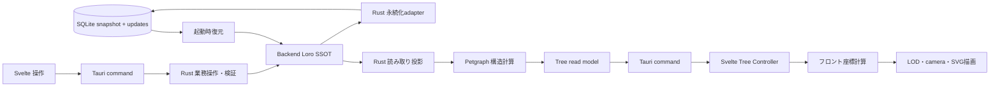

# Tauri移行計画とTreeの責務分担

作成日: 2026-10-11
状態: 移行計画。BackendのLoroをSSOT、SQLiteをsnapshot＋差分Updateの永続化先とする方針を追加。実装・性能・互換性は未検証。
調査基点: ローカルHEAD `9f3dcaf`。開始時点の未コミット変更を含む作業ツリーを参照した。main反映や移行実装の完了を示す文書ではない。
Loro追補の照合基点: `poc/loro-undo` HEAD `faa8c16`、ローカルmain `8acc2af`。詳細な根拠・障壁・先行PoC仕様は[Loro Backend移行調査](loro-backend-migration-research.md)に記録する。

## 1. 方針

**Tauri 2 + Svelte 5を維持し、BackendのLoroを保存対象データのSSOTとする。SQLiteにはLoroのsnapshotと差分Updateを永続化する。ControllerはBackend APIを通してアクセスする。**
Rustのserviceが業務上の検証とLoro操作を所有し、Petgraphがグラフの構造計算、フロントが座標・表示・操作を担当する。UI draft・選択・focusまでLoroへ移さず、Loroの型をViewやIPCへ露出しない。SQLiteの検索索引等を追加する場合も、Loroから再生成できる派生データとする。

製品モデルには[Topicルート/文書設計](topic-document-design.md)も適用する。最上位block＋子孫を文書とし、
タイトルもblock、アウトライナー操作と内部block参照を維持する。Work/Occurrenceとの対応は未決定であり、
既存モデルのLoro対応案を最終schemaとしない。保存技術の検証と製品モデルの変更を分け、両方の受入を示す。

最初は現行の `tree_layout.ts` とSvelte/SVG・D3操作を使う。ELK.jsはLineageの配置を置き換える比較候補とする。Dagreは単純な階層図が要件を満たす場合の候補に留め、三方式を製品の設定として常設しない。

Petgraphはグラフのデータ構造とアルゴリズムを提供するライブラリであり、保存、Radiora固有の関係型、UI状態、座標配置をまとめて所有するものではない。[Petgraph公式](https://docs.rs/petgraph/latest/petgraph/)
ELK.js/Dagreは座標計算を担当し、ノードの描画や選択・編集操作は別途必要になる。[ELK.js公式](https://github.com/kieler/elkjs)、[Dagre公式](https://github.com/dagrejs/dagre)

今回の対象は設計・計画の文書化。依存追加、Tauri雛形、DB変換、Rust移植は行わない。

## 2. 移行理由と前提

Denoは2026-10-09の公式発表で、runtimeのバグ修正・セキュリティ更新を月次であと1年間提供し、その後は自社での開発を終了すると発表した。OSSとしての継続可能性と、Deno社による保守終了は区別する。Deno Desktop固有のサポート期間はこの発表から断定できない。[Deno公式発表](https://deno.com/blog/cloudflare)

このため、Deno Desktopへの新たな依存を増やさず、配布アプリのruntimeをTauriへ移す。移行期間の旧版と検証用Deno CLIは維持できるが、最終配布アプリのDeno同梱は終了する方針とする。残る開発用Denoタスクも後述のM5で移行する。

TauriはシステムWebViewを利用するため、現在のCEFと同じ描画エンジンではない。WindowsはWebView2、LinuxはWebKitGTKを使う。軽量化や性能改善は期待だけで採用根拠にせず、同じデータと操作で実機比較する。[Tauriアーキテクチャ](https://v2.tauri.app/concept/architecture/)

## 3. 現行コードの移行地図

| 現在の責務 | 確認した実装 | 移行方針 |
| --- | --- | --- |
| 起動・Window・HTTP・終了処理 | [main.ts](../../src/main.ts)、[desktop bindings](../../src/desktop/register_bindings.ts) | Tauriの起動とcommandsへ。composition rootには配線・委譲を置く |
| フロントの呼出し | [rpc_adapter.ts](../../src/ui/rpc_adapter.ts)、[bindings.ts](../../src/shared/bindings.ts) | Controllerのportを維持し、HTTP transportをTauri invokeのadapterへ置換 |
| Tree対象の抽出・代表配置・暗黙関係・filter | [branch_service.ts](../../src/services/branch_service.ts)、[global_lineage_filter.ts](../../src/services/global_lineage_filter.ts)、[implicit_relation.ts](../../src/services/implicit_relation.ts) | Rustの読み取り投影へ段階移植。Petgraphに業務判断を委ねない |
| 世代・循環 | [tree_lineage_projection.ts](../../src/ui/tree_lineage_projection.ts)、[tree_lineage_cycles.ts](../../src/ui/tree_lineage_cycles.ts) | Rust/Petgraphへ。既存fixtureで意味の一致を証明 |
| 表示順のための隣接走査 | [tree_lane_order.ts](../../src/ui/tree_lane_order.ts) | 最初は維持。Rustへ移すなら順序と代表Occurrenceの契約も移す |
| 座標・ラベル寸法・LOD集約 | [tree_layout.ts](../../src/ui/tree_layout.ts) | フロントで維持。Lineageの座標計算のみELK比較 |
| 描画・camera・pointer・focus | [PhylogeneticTree.svelte](../../src/ui/PhylogeneticTree.svelte)、[tree_pointer_adapter.ts](../../src/ui/tree_pointer_adapter.ts)、[tree_camera.ts](../../src/ui/tree_camera.ts) | Svelte/SVGとD3をまず再利用。WebView実機で操作を確認 |
| 歴史年代の年表 | [HistoricalTimeline.svelte](../../src/ui/HistoricalTimeline.svelte)、[historical_timeline_layout.ts](../../src/ui/historical_timeline_layout.ts) | 通常Treeとは別の時間投影として維持 |
| Treeの設定・取得・公開 | [tree_controller.svelte.ts](../../src/ui/tree_controller.svelte.ts) | 所有と要求失効を維持。非同期レイアウトにも公開条件を適用 |
| DB・保存復元 | [storage_bootstrap.ts](../../src/storage/storage_bootstrap.ts)、[sqlite_store.ts](../../src/storage/sqlite_store.ts)、[sqlite_records.ts](../../src/storage/sqlite_records.ts) | record形式を新Loro docへ変換し、SQLiteをsnapshot＋差分の保存先へ変更。旧DBは保全する |
| 配布・更新・監査 | `scripts/desktop_*`、[release workflow](../../.github/workflows/release.yml)、[deno.json](../../deno.json) | Tauriのdev/build/bundleへ。更新・署名・installer・監査は個別検証 |

既存の[UI所有契約](ui-state-ownership.md)、[Tree所有契約](tree-state-ownership.md)、[画面復帰契約](outline-screen-navigation.md)、[永続化契約](storage-persistence-contracts.md)の振る舞い・データ保護を基準とする。SQLiteの継続と、recordを正本とする現在の保存方式の維持は別。main側のADR 0003の限定導入案との相違は追補§6.5で扱う。

## 4. 目標のModuleとInterface

図は最終構成。現行TypeScriptのバックエンドがTauriに自動移植されることを意味しない。

### Rustが所有すること

- Loro doc、操作単位の検証・直列化、SQLiteへのsnapshot/Update保存・復元。Loro commitとSQLite transactionを区別する。
- 保存対象のWork/Branch/Occurrence/Revision/Linkの不変条件と、保存成功後のread model公開。
- filterを適用した読み取り投影、暗黙関係の生成、代表Occurrenceの選択規則。
- 意味グラフの隣接・到達・SCCなどの構造計算と、Radioraのルールによる世代・結び目の決定。
- 計算に使ったデータ版と、投影条件を識別できる値。

Petgraphのインデックスを永続IDやIPCのIDとして公開しない。Work/Occurrence/Linkの既存IDと内部インデックスの対応をRust側に閉じ込める。最初は要求ごとに構築するグラフでよく、常駐する更新グラフ・差分キャッシュは計測後に判断する。

Outlineの配置階層、Work間の意味グラフ、Revisionの履歴DAGは別の構造である。ひとつのグラフへ混ぜない。循環を許す意味グラフに、履歴DAGの禁止条件を流用しない。

### フロントが所有すること

- 画面寸法、フォントとラベル寸法、world座標、edgeの描画経路。
- camera、hover、viewport除外、screen空間でのLOD・clusterと選択表示。
- featureのdraft、投影/filterの設定、最新要求の公開、画面復帰・focus/caret。

Rust側の構造的SCCと、ズーム時に画面上で重なるノードのclusterは別物。後者をPetgraphへの移植対象にしない。

### commandを通すInterfaceの契約

初期は既存 `listGlobalLineage` の出力を維持する。Rust計算を追加する段階で、そのread modelに世代・循環membershipを含め、Viewで再計算しない。DTOの具体的なschemaとcommand名はM0で固定する。

必要な情報は、既存の表示ノード/Work/Occurrence ID、edgeのID・endpoint・型・状態・由来、世代、循環Work ID、投影条件・データ版。ELKの内部graphやPetgraphの型をInterfaceへ漏らさない。`Map`/`Set`はJSONで運べる配列・recordへ変換する。

Rust入力はSerdeによる形の検査に加え、ID・関係型・参照先・操作権限・業務不変条件を検証する。フロントも受信DTOをruntime validationする。TypeScriptの型注釈だけで通信の正しさを保証しない。日時、数値範囲、欠損・null、error code/messageの対応を契約テストで固定する。

UI要求の取消は結果の公開を失効させる。完了したDB書込みを巻き戻さない。Rustの重い計算・同期DB処理はWebViewやcommand処理を塞がない実行方法を選び、DBのwriterを一箇所にする。

## 5. レイアウトと描画ライブラリの選択

| 候補 | 任せる範囲 | Radioraでの扱い |
| --- | --- | --- |
| 現行 `tree_layout.ts` | 時刻/世代の横軸、lane、ラベル占有幅、screen集約 | 移行時の基準実装。独自の意味を最も維持しやすい |
| ELK.js | layered配置、edge routing、複合構造など | Lineageの第一比較候補。Worker利用・非同期結果の失効・bundleを検証 |
| `@dagrejs/dagre` | 有向グラフの階層配置 | 小さな要件で十分なら比較。世代制約や複雑なroutingの充足をfixtureで確認 |
| SvelteのSVG + 既存D3 adapter | 描画、pan/zoomなどの操作 | 初期採用。現在すでにライブラリへ操作を委任している |
| Svelte Flow | ノード表示とグラフ操作の基盤 | 描画/操作も置換したい場合の別評価。ELK/Dagreの代替ではない |

能力の一次資料は[調査ノート](tauri-migration-research.md)を参照する。上表の採用優先度は本プロジェクト向けの判断であり、性能優劣の測定結果ではない。

**Chronologyのx座標は時刻に意味があるため、一般的な階層配置で上書きしない。** 歴史年代の年表も同様。LineageでもELKが選んだrankをRadioraの「世代」と同一視しない。世代の横位置と結び目専用位置を維持できなければ、現行layoutを採用する。一般グラフ表示を追加する必要は今回ない。

現行の循環Workは結び目へ置かれ、残るノードの世代は循環ノードを除いた計算で決まる。SCCを縮約して通常DAGの世代を計算するだけでは同じ意味にならない。また、世代計算のedge方向と描画用FROMの向き、laneとedgeの代表Occurrenceには別の既存規則がある。移植時に統一しない。

ELK導入時はノード幅/高さを入力し、返された座標・bend pointsを既存の描画へ接続する。DOM ID・選択ID・cluster constituent IDを安定させ、engine都合で変更しない。非同期化は既存の同期 `$derived` をPromiseへ置換するだけでは足りず、要求管理が必要になる。

panでは構造計算/ELKを再実行しない。zoomも原則としてcameraとLODだけ更新する。ただし現行layoutは画面上でラベル寸法を一定にするためzoomに応じてlaneの占有幅を変える。この挙動を維持するか、固定world layoutへ変更するかはM3の比較項目とし、ラベル重なりの退行を許さない。

Svelte Flowへの置換ではcamera/selectionのowner、キーボード移動、集約ノード、時間軸、スクリーンリーダー、既存context menuが適合するかを見る。ノード接続編集のような新しい要件は今回追加しない。

## 6. バックエンド移行の選択

**推奨は、保存・業務上の不変条件・大きな構造計算をRustへ移し、Svelteの状態所有と再利用できる純粋なTypeScript処理を残す段階移行。** 既存serviceの全メソッドをRustへ直訳する計画にはしない。「グラフ計算だけRust」と「Deno runtimeを配布から外す」は別の仕事である。

| 経路 | 利点 | 費用・判断 |
| --- | --- | --- |
| Rustへfeature単位で再実装 | 最終runtimeがTauri/Rustに収まる | 振る舞い・データ・保存契約を保持し、保存/query/計算の実装は変更する。独立したTS表示処理は残す。推奨 |
| 一時的なNode sidecarでTSバックエンド維持 | service資産を早期再利用できる可能性 | Deno I/O・JSR・起動/終了・IPC・配布の互換確認が必要。納期上必要な場合だけM0で選ぶ |
| Deno sidecarを継続 | 既存バックエンドを流用しやすい | Deno依存終了の目的を達成しない。最終構成には採用しない |

Rust移植が機能の早期提供に間に合わない場合はNode sidecarを別案として見積もる。今回はsidecar実装や互換shimを先行作成しない。移行途中のTauri版は対応済みの操作だけを検証し、未対応commandを成功扱いしない。

### 6.1 保持する振る舞いと置き換える実装（2026-10-11追補）

SQLiteを維持しても、現在の保存方法まで維持する必要はない。移行の単位はファイルやserviceクラスではなく、ユーザー操作と、その操作が守る不変条件とする。

現行 `SqliteGraphStore` は `MemoryGraphStore` を継承するが、すべての保存が全state diffではない。
`SqlitePersistence.mutateTargeted` は局所更新とrollbackを行い、構造変更等は全state export/diff/restore経路へ分岐する。[保存境界](../../src/storage/sqlite_persistence.ts#L60-L90)
現在の `listOutline` は項目・Knotを読み、再帰配置等を投影する処理であり、Knotを書き戻さない。[Outline操作](../../src/services/occurrence_operations.ts#L39-L48)
2026-10-11時点の説明を現在の退行や移植要件にしない。これらの実行手順は互換性の対象から外し、表示結果・保存結果・失敗時の保護を対象にする。[性能監査](../performance-audit-2026-10-08.md)は別HEADでの過去の単体測定であり、今回の性能測定ではない。

| 対象 | 保持するもの | 再利用・置換・保留の判断 |
| --- | --- | --- |
| Work/Branch/WorkingCopy/Occurrence/Revision/Link | ID、既存本文/履歴/配置、複数配置、pinned read-onlyなどの意味 | データと不変条件を保持。現行クラス階層は移さない |
| 本文保存・復元・破棄 | 同branchの配置同期、draft保護、失敗通知、保存の整合性 | 保存をRustの操作単位transactionへ再設計。全stateのclone/diff/rollbackを通常保存へ持ち込まない |
| 配置移動・削除・全collapse | 順序、子の昇格、循環/再帰配置の表示、操作後の結果 | 操作単位でまとめて検証・保存。子ごと/行ごとのRPC・全再計算を置換 |
| Outline/Treeの読取り投影 | filter、代表配置、暗黙関係、選択表示例外 | 読取り時のDB書込みを外す。Knot等の正しい導出・更新時点は別途固定 |
| Svelte Controller/Workspace | state owner、要求世代、draft、guard、選択、画面復帰 | 再利用。ただし全feature一律reloadの配線は変更する |
| Markdown表示・export等の純粋なTS処理 | 書式、参照表現、出力形式 | I/Oと切り離せる処理はTSで再利用する候補。保存の権威をフロントへ移さない |
| 検索・逆参照・タグ | 保存データ、参照の正しさ、必要な検索入口 | 全文/全履歴の反復走査を移さず、取得範囲・更新単位を再設計。ランキング高度化は別の採否判断 |
| Tree世代・循環・隣接 | 投影の意味と安定順序 | Petgraph等へ構造計算を委任。入力変更時の計算とcamera操作を分離 |
| Outlineの可視行・editor表示 | 行順、IME、focus/caret、編集継続 | 多rootの反復find・深い再帰を置換。目標可視行数が大きければviewport仮想化を設計 |
| 提案・高度なquery・比較画面・操作統計 | 保存済み定義/feedback等のデータ | 初回移行から保留する候補。優先度は未決定で、今回機能を削除しない |
| Deno Desktop用HTTP/HMR/CEF配布 | 必要な起動・診断・配布能力 | Tauri方式へ置換後に旧実装を撤去。ログ/エラー報告の機能は維持 |
| Memory/JSONのstore実装 | テストfixture、JSONバックアップ/復元の互換性 | Rustへ三種類の同形storeを再作成しない。製品のJSON通常保存モードを終えるかは別決定 |

「機能を後回しにする」と「その保存データを捨てる」は別の決定とする。画面を提供しない機能のデータも、保存・export・restoreで往復できることを証明する。未知データを黙って落とす全体復元/再保存は行わない。

### 6.2 保存・読取り・UI更新を操作別に設計する

通常の保存は「対象と依存先を読む・検証 → Loroへ操作を適用・commit → 保存済みVersion Vector（VV）から差分export → 差分と保存済みVVを一つのSQLite transactionで保存 → 保存成功後にread modelを公開」とする。
**通常更新の成功は差分UpdateのSQLite保存成功まで。全snapshotの生成・保存を毎回待たない。** 初回導入・明示checkpointはsnapshot保存transactionの成功までをその処理の成功条件とする。
LoroにはACID rollback/isolationがないため、SQLite失敗でLoroまで戻ったと扱わない。保存失敗時の保護と再試行は§6.5の先行検証で固定する。DB全体のcloneを通常保存の前提にしない。

| 操作 | 保存と更新の範囲 | 避ける処理 |
| --- | --- | --- |
| 本文1件保存 | 対象WorkingCopyと関連Work等。表示名・参照・タグ・検索等の本文依存結果を失効し、同branchの配置へ反映 | 関係ない全履歴/graphのcloneと比較、世代/隣接の無条件再構築 |
| collapse1件 | 対象Occurrence、Outlineの行表示と必要な配置依存表示 | collapseだけを理由とする意味グラフの再計算・全bookmark取得 |
| 移動・子の昇格削除 | 対象と関係する親子/順序/暗黙関係/循環を操作単位で確定 | 子ごとの独立commit、読取りによるKnot再保存 |
| 意味link/関係型の変更 | endpoint・型の検証、保存、依存するTree/検索/注釈等の失効 | 本文や無関係のeditor draftの置換 |
| caret/復帰位置 | 復帰recordを適切にまとめて保存 | 本文/履歴の全体diffやgraph再計算 |
| JSON復元・merge・purge | 広い依存の検証とtransaction、必要な全体再読込 | 通常単件更新と同じ局所処理だけで済むという仮定 |

全体検証はimport/restore等の信頼境界に残す。単件操作では関係する不変条件を局所検証するが、その依存先を列挙できることが前提。局所化のためにvalidationを削らない。

Knotを含む構造計算は、最初は「構造変更後に一度全体計算」でもよい。移動のたびの局所SCC更新まで先行実装せず、少なくとも本文/caret/panから切り離す。常駐グラフcacheを入れる場合はDB commit後の失効と失敗時の扱いを必須にする。

変更種別と影響IDを操作結果として返すか、既存portから必要な読み取りを呼ぶかは具体的なcallerで決める。汎用のevent bus、差分query engine、全画面共通の巨大storeは先行導入しない。必要範囲の再読込でも、snapshot/draft分離と最新要求だけの公開は維持する。

SQLiteは現在、recordのID/positionとJSON payloadを中心に保存している。[schema](../../src/storage/sqlite_schema.ts)
新方式は旧record schemaのままでは実現しない。旧schemaは移行元readerとして維持し、別DBへLoro snapshot/Updateと形式versionを保存する。親子・検索・逆参照はLoro由来のread modelとして設計し、必要なら派生索引を追加する。既存recordとLoroを両方の正本にするdual-writeは採用しない。

### 6.3 Rustへ移す範囲を狭める

Rust必須の候補は、DB/I/O、永続化の不変条件、transaction、大きな構造走査。小さな純粋計算をRust化すること自体を目標にしない。TSで使える表示/parser/formatterを残すことで、移植するコードと検証量を減らす。

ただし保存規則の正本はRust側とし、フロントが返した解析結果を無検証で保存しない。内部参照やmerge時の本文書換えなど、保存の意味を決める処理をRustへ移す場合は文法・範囲・errorのfixtureを共有する。JSのUTF-16 offsetとRust文字列のbyte offsetを混同せず、日本語・絵文字・改行を含むfixtureで変換を検証する。

既存テストは振る舞いの証拠として再利用する。内部クラス、RPC回数、全reload、全state rollback等の現実装を前提にしたテストは、保持すべき契約と実装依存に分ける。意味を変えないつもりで既知のバグまで互換性要件にしない一方、意味を変える箇所は仕様変更として別に記録する。

### 6.4 機能を減らす判断と最初の検証単位

M0では各機能に「初回移行に必要」「後続で提供」「廃止候補」を付け、保存データ、caller、設定、入出力、回帰を対応付ける。本書は後続/廃止の候補を示すだけで、機能廃止を確定しない。全commandの一対一再現ではなく、採用したユーザー操作と不変条件の成立を完了条件にする。

最初に検証する縦方向のsliceは、コピーDBの既存本文を表示し、編集し、一件保存し、同branchの別配置へ反映し、再起動で読み戻す処理とする。pinnedへの編集拒否、保存失敗時のdraft維持、古い応答の棄却を含める。本文に内部参照を含む場合は依存の失効も確認する。

このsliceでLoro操作/export時間、差分bytes、走査量、SQLite transaction時間、queue待ち、IPC量、paintを分離して計測する。全体データ量を増やしても、通常保存が毎回の全snapshotや無関係の全recordの複製・比較を要求しないことを確認する。checkpointと広い本文依存queryの費用は別記し、実行時間を厳密なO(1)とは約束しない。

ここが成立してから他の機能を載せる。shellの表示とELK比較だけを先に完成させて、旧保存方式を最後に直訳する進め方は採らない。

### 6.5 Loroへの正本移行の先行条件

- **保存・公開境界**: Backendの単一writerが検証から永続化までを直列化する。Loroの通知をそのまま「保存済み」として配信せず、保存した版を確認して公開する。UI要求が失効しても完了した保存は戻さない。
- **読取り境界**: 保存中・dirtyのdocを通常queryで読んで未保存値を漏らさない。初期は同じownerでreadも調停し、保存済みread modelを返せない場合は明示的に読取りを拒否する。エラー待ちのqueueで無期限に停止させない。
- **失敗時の推奨**: SQLite保存失敗時は適用済みLoro状態を未耐久のdirtyとして保持し、保存済みVVを進めず、そのdocの後続mutationを停止する。同じ差分の永続化を再試行し、成功後だけ公開・再開する。UI draftは保持する。複合操作の途中適用失敗は別問題であり、再起動復元等で安全に隔離できることをPoCで証明する。単純な再実行・UndoManagerによるrollbackはしない。
- **再試行**: commandのrequest IDと保存結果の対応を永続化transactionへ含め、保存後の応答喪失でも追加・移動等を二重実行しない。実schema/APIはPoCで決める。
- **checkpoint**: 初期はwriterを止めた保存済みの版から生成し、新snapshot・対応VVの保存と、そのsnapshotに取り込み済みの差分だけの削除を同一transactionで行う。未保存状態・依存待ちのimportがあれば集約しない。失敗時は旧snapshot/差分を残す。Loroの集約とSQLite WAL checkpointは別処理。
- **保持方針（合意済み）**: 永続化snapshotは最新1世代＋それ以降の差分を保持する。日数で削除せず、置換成功時に旧snapshotと取り込み済み差分を削除する。集約周期は差分件数・容量・復元時間のPoC結果で決める。内部操作履歴の切捨ては別判断とし、Recovery Snapshot・Revision・backupの保持と連動させない。
- **耐久性**: 先行測定の候補はWAL＋`synchronous=FULL`。現行DELETEとの比較条件を残し、NORMAL/OFFによる保証の低下を性能改善と混同しない。停電耐性はOS/VFS/ストレージの契約も伴い、プロセス強制終了の試験だけで証明しない。
- **互換性**: WASM `loro-crdt` 1.16.4とRust `loro` 1.16.2を最初の候補とし、lockfileで内部依存も固定する。番号の違い自体は非互換の証拠ではないが、共通実装・安定binary formatだけでアプリの移行完了とはしない。snapshot＋Updateを双方向で往復させる。
- **モデル**: doc分割、複数docの原子性、Branch単位の本文、Occurrenceの複数配置、安定した業務ID、Revision/Recovery Snapshotを先に対応付ける。[対応案](loro-backend-migration-research.md#31-現行モデルからloroへの対応案)はLoroTreeを配置の木、Workを独立したMapとして扱う。Loroのsnapshot、製品のRecovery Snapshot、UI snapshotは別物。
- **schema**: Loro binary format、SQLite保存envelope、Radiora doc内部schemaを別にversion管理する。docのフィールド追加・変換もmigrationとして扱い、未知version拒否と旧データ保持を検証する。
- **undo**: Backendの共通docで全ペインの操作が同じpeerになると、単純なUndoManagerでは他ペインまで対象になる。セッション別undoの実現を先行検証する。共同編集・端末同期は今回も非目標。

main `8acc2af`のADR 0003は文面上Proposedで、決定1/9の「編集セッション内だけ・Controller所有」、決定10の「既存DBへの投影」は今回の方針と異なる。実装前に後続ADRで置換関係を明示し、UI/永続化所有契約を更新する。決定5の「Loro IDを永続化しない」も、「binary内部には含まれるが、業務ID・RPC IDとして公開しない」へ精密化が必要。本worktreeにないmain側の文書を移行済みとして書き換えない。

先行PoCの再現条件・障害注入・1万件測定は[調査ノート§4](loro-backend-migration-research.md#4-先行pocの仕様未実装)に定義する。計画更新の完了と、この検証の合格を区別する。

## 7. 段階計画と完了条件

| 段階 | 作業 | 終了条件 |
| --- | --- | --- |
| M0: 契約・範囲の固定 | `RadioraBindings`の全methodとcallerを棚卸し。Loroモデル、doc境界、保存成功/失敗、undo、互換性、旧データ変換・rollbackを固定 | 採否と再設計を別記。既存ADRとの差を記録し、先行PoCの評価条件を固定できる |
| M0-L: Loro永続化PoC | WASM/Rust往復、snapshot＋差分のSQLite保存・復元、失敗/再試行/強制終了、1万件データの性能を独立検証 | 保存成功済みデータの復元・安定ID・日本語位置・セッション別undoが成立。p50/p95/p99と未達条件を記録し、採用を判定できる |
| M1: Tauri shellと読取り | Vite/Svelte UIを載せmockで起動。コピーした旧SQLiteを別の新DBへ変換・検証し、Loro由来read modelをinvokeへ接続 | Windows実機でOutline/Treeの表示、IME、keyboard、focus、pan/zoomが動く。旧本番DBへ書かず、変換前後のデータが一致する |
| M2: Petgraph構造計算 | 現行filter/暗黙関係/代表配置を含むTree read modelと世代・循環を移植。TSとRustを同fixtureで比較 | ID、edge向き、世代、循環membership、孤立node、順序が一致。フロントの重複構造計算を取り除ける |
| M3: layoutの比較 | 同一read modelで現行対ELKを比較。必要ならDagreも追加比較。非同期公開、寸法/edge経路、camera/LODを接続 | 時間/世代/結び目・選択が正しく、実機で性能を比較できる。一方式を採用し不採用依存を残さない |
| M4: 保存と業務操作 | 本文保存・再起動・障害時保護のsliceを、Loro単一writerと差分永続化で証明。その後Work/Branch/Copy、Occurrence、Link、Revision/Recovery、検索/提案、bookmark/復帰、入出力を再実装 | 振る舞い、保存成功後の公開、失敗時dirty/retry、局所更新、draft、再起動、バックアップ復元を証明。保留機能の保存データも保護 |
| M5: 配布とruntime終了 | dev/build/CI/テスト/ライセンス、署名/installer/更新、startup/log/cache、旧データ導入を移行。旧Desktopと残るDenoタスクを撤去 | release artifactにDenoが不要。各対象OSの実機試験とデータ復帰手順が通る。残る制約を公開できる |

M0-Lを保存方式の実装前gateとする。M1の読取り確認後、M4の本文保存sliceを先に行い、保存経路とUI更新を検証する。全機能の書込み対応はその後に進める。M2/M3はread modelを固定後、残るM4と別の変更として進められる。M3でELKが不採用でもTauri移行は進める。実装量が未確定なので日数は断定しない。各段階のPRには固定base、完了した契約、未完了項目、検証結果を記録する。

最初の実装単位はM0の一覧とM0-Lの保存・互換性PoC。Tauri shellだけで「移行完了」としない。

### 7.1 現行版の凍結・切替とIssueの実行順

[現行版の退出gateとIssue実行計画](tauri-loro-transition-backlog.md)を本節の具体化とする。
43件の既存Issueをすべて現行TS実装で完了させることを移行条件にしない。
現行版の機能追加凍結、検証コピーによる新版開発、日常利用先の切替、旧runtimeの保守終了・撤去は別の判断とする。
ユーザーは現行版の新機能追加凍結を承認し、昨日までの性能/UI改修を反映したv0.7.0のreleaseと、
ここまで挙げた新機能のTauri版実装を決定した。具体的な収録差分・release検証は別作業であり、公開済みではない。
本書のM0〜M5は技術上の作業分類であり、M2/M3完了までM4の保存sliceを待つという実行順ではない。
GitHub Projectsは既存Issueと移行固有の検証作業を関連付け、仕様決定・PoC合格・main反映・配布完了を混同しない。

## 8. データ・設定・復帰の保護

- SQLiteを継続するが、旧recordと新Loro binaryではschemaが異なる。旧DBは変更せず、別DBへ展開・変換・再起動検証・採用の順に進める。payload、並び順、version、日時、関係型定義を保持し、変換の再実行は二重登録しない。
- 現行Windowsの通常DBは `RadioraV2/turso/radiora.db`。Tauriのapp data pathが同じになると仮定せず、旧パス検出・明示選択・バックアップ・コピー・検証・採用の順を設計する。旧 `surreal` とmigration markerの検査も保持する。
- SQLiteコピーは旧アプリの終了・接続close後か整合したbackup手段で行う。稼働中のDB本体だけをコピーせず、WALを含む整合性を確保する。初期検証は専用コピーで行う。
- 旧版と新版で同じDBへ同時に書かず、dual-writeしない。採用前のrollbackは旧DBへ戻る。採用後に新しい編集を旧版へ戻すには、互換export/importの往復検証が必要。未検証なら新版DBを保管し、編集を無損失で戻せるとは案内しない。未知versionの起動は非破壊で拒否する。
- JSONバックアップ、Markdown/OPML入出力、Revision/Recovery、purge manifestなど、Tree表示外の保存データも欠落を検査する。[永続化対応表](storage-persistence-contracts.md)を基準にする。
- WebViewのorigin変更によりlocalStorageの設定は自動継承されない可能性がある。Tree filter/projection、theme、layout、editor設定を棚卸しし、旧版からのexport等の移行手段を決める。
- startup snapshotは描画キャッシュとして扱い、BackendのLoro正本やその永続化データを上書きしない。未保存draftを保存済みデータと混ぜない。
- Tauriのcommand・plugin権限を限定する。任意SQL、任意パス書込み、任意shell実行をフロントへ公開しない。custom commandのACLも別途設定・検証する。[Tauri command権限](https://v2.tauri.app/security/permissions/)

## 9. 回帰・性能の証明

既存の[Tree回帰](../../src/ui/tree_layout_test.ts)、[循環回帰](../../tests/tree_lineage_cycles_test.ts)、[Tree Controller回帰](../../vitest/tree_controller.svelte.test.ts)、[高密度fixture](../../tests/support/high_density_graph_fixture.ts)を再利用する。TSとRustの比較fixtureは一つの正本にし、非決定的な配列順は契約に従って正規化して比較する。

| 軸 | 必須ケース |
| --- | --- |
| 意味 | Workの複数配置、暗黙/明示関係、FROM向き、独自関係型、撤回、filter、選択表示例外、孤立/空 |
| 構造 | 複数root、diamond、循環・自己loop、循環の前後のnode、履歴DAG、入力順変更、安定ID |
| 配置/表示 | 同時刻、長い日本語ラベル、世代位置、結び目、極端zoom、LOD/cluster、再寸法、viewport |
| 要求寿命 | filter/projection/選択変更、応答逆順、旧失敗/finally、Treeを離れる、dispose、Worker終了 |
| 保存 | 本文/配置/関係の保存失敗、複数操作の直列化、復元の途中失敗、再起動、旧schema、未知schema |
| Loro | WASM/Rust双方向のsnapshot＋差分、依存欠落/重複import、保存済みVV、途中適用失敗、保存後応答喪失、checkpoint途中終了、ペイン別undo、履歴増大 |
| 実機 | IME、caret、pane/画面復帰、context menu、touch/wheel、gesture中unmount、download/dialog、accessibility |

[既存性能監査](../performance-audit-2026-10-08.md)はTreeの再計算と保存の全体処理を指摘している。RustやELKを入れただけでこれらが消えるとは仮定しない。過去の単体測定はGUI/WebViewの実測と区別する。

比較はrelease build・同じ端末・seed/data・操作で行い、fixture準備を計算時間から分ける。まず既存3,000 Works/24,000保存linksを使い、深いchain・hub・同時刻集中を追加する。計算時間、IPC bytes/往復、Workerへの転送、inputからpaint、pan/zoom frame、DOM数、heap、DB commitを分けて記録する。中央値とp95を取り、エラー/timeoutも結果として残す。

仮の採用目安は、入力からpaint p95 50ms未満、pan/zoomが対象端末のframe budget内、通常単件操作p95 100ms未満。これは現状の保証ではなくM0で合意する目標である。初期layout時間は現行との比較と許容待機時間を別に決める。満たせなければ転送量・再計算回数・LOD/描画量を調べる。

Loro保存の「一桁ms」は未検証の仮説とし、1万件のWorkを保持した状態での単件差分保存p95 < 10msを先行PoCの評価目安にする。1万件の全件保存時間や平均値で代用しない。差分exportからSQLite commitまでと、検証・queue・IPCを含む操作全体を別に報告し、正式な採否は対象端末の結果で判断する。

## 10. 残る決定と今回の終了点

1. M0で機能の採否と再設計の範囲を確定してからRust再実装の規模を見積もり、早期提供にNode sidecarが必要か判断する。
2. 対象OS・installer/MSIX等・更新配布・署名を確定する。既存配布方法とTauri標準bundleの互換性は未検証。
3. Lineageの世代横軸と結び目をELKで維持できるか、ラベル固定サイズとzoom時のlane変更をどう扱うか比較する。
4. Rust Loro/SQLite crateの固定version・features、doc境界、undoのsession分離、writer実行方式、耐久性設定をM0-Lで検証する。TS/Rust DTOと重い計算の実行方法はM1で固定する。
5. 描画もライブラリへ委任したい場合、Svelte Flowを既存操作契約に対して評価する。今回はSVGを基準とする。

本書、[Tauri一次資料](tauri-migration-research.md)、[Loro Backend移行調査](loro-backend-migration-research.md)を計画の成果物とする。既存READMEの現行構成やADRは、実装前に移行済みの記述へ変更しない。Loro追補時点でM0-Lの実装・ベンチマークは未実施。
