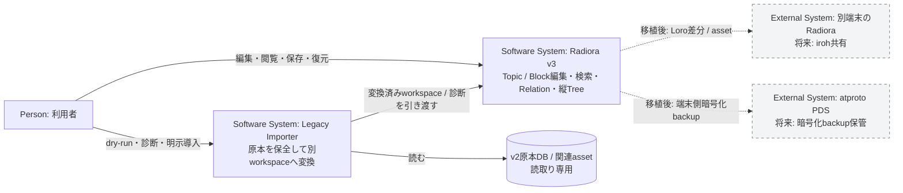
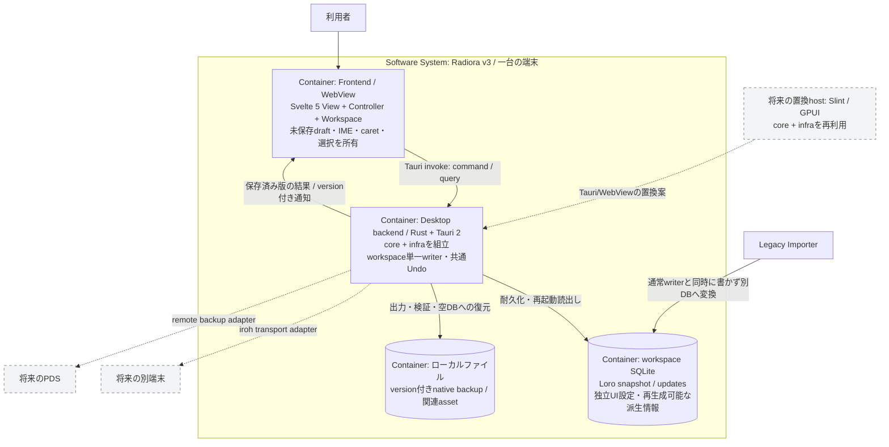
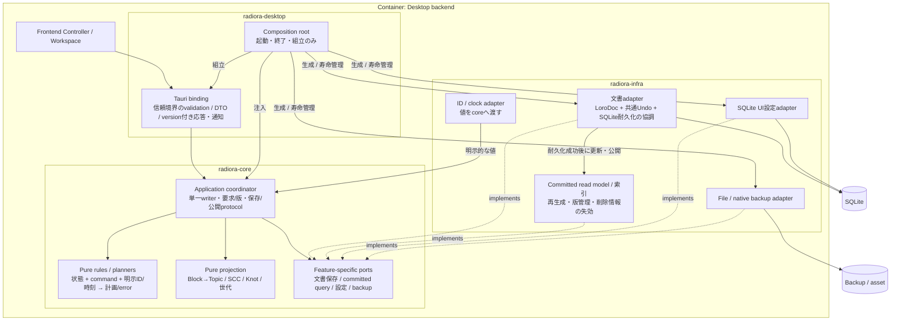
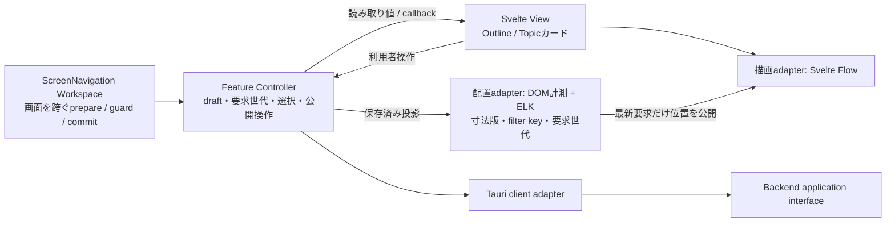
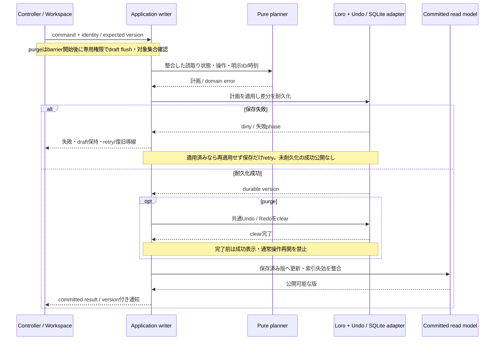

# Radiora v3 C4アーキテクチャ図

整理日: 2026-10-31。ユーザー採用済みの**目標構成**を図示する。 現在はCargo
workspace/依存と品質gateの入口までで、図の製品機能は未接続。
設計契約は[v3 architecture](v3-architecture.md)、製品仕様は[v3決定事項](v3-model-decisions.md)。
C4のContext / Container / ComponentをMermaid flowchartで表現し、保存のDynamic viewを添える。
Containerは実行・保存の単位、Componentはその内部責務。crateとprocessを同一視しない。

## C1：System Context

iroh/PDSは初回対象外。図は同期時の認可・Undo・削除やPDSの鍵管理/保持を確定しない。
Importerは通常UIのwriterとは別の導入工程で、原本変更/in-place/dual-writeを行わない。

## C2：Container

backendはdesktop hostと同一processを基本とし、WebViewのprocess構成はruntimeに従う。
UI/backend間はTauri IPCであり、独立HTTP serverを追加する設計ではない。 native hostは現在のTauri
hostへ通信する追加クライアントではなく、その置換先を示す。
LoroDocはbackend内の文書モデル、SQLiteのsnapshot/updatesが耐久表現。独立した二つの文書正本を作らない。
fold/カード開閉はSQLiteのUI設定。文書Loro・共通Undo・将来の文書同期から分離する。

## C3：Desktop backendのComponent

実線は利用/データ受渡し、implements線はinterfaceの実装関係。
portはcore側が定義し、実装への呼出しは注入したportを通る。Loro/SQL/Tauri型をcoreの公開契約へ漏らさない。
索引の保存形態/更新方式と通知protocolは実装時の残件。図は索引の独立正本化やwriter増設を要求しない。
Loro適用・export・耐久化・Undo・purge barrierを汎用CRUDの独立transactionへ分解しない。

## FrontendのComponentと交換箇所

layoutへ渡すのは論理IDと投影/寸法で、座標やSvelte Flow Nodeを文書正本にしない。
Slint/GPUIへの移行ではView、editor、IME/caret、UI adapter、layout接続の再実装・実機検証が必要。
core/infra再利用はUIを無変更で交換できる保証ではない。

## Dynamic view：編集・耐久化・公開とpurge

異常時の正確な権限/禁止は[purge契約](purge-undo-contract.md)を優先する。 SQLite
commit後・応答前、およびdurable後・clear前のcrashを[V01/V12・A01](v3-verification-plan.md)で検査する。
図はLoroメモリとSQLiteを一つのACID transactionにできるという意味ではない。 command
identity/dedup、read model更新失敗、購読再接続、thread/実行方式の具体型は保存sliceで固める。

## 検証・運用への接続

| 対象                         | 確認方法                                                                                    |
| ---------------------------- | ------------------------------------------------------------------------------------------- |
| Pure core / graph            | proptest、独立oracle、固定反例：V02〜V09/V11/V12                                            |
| Application protocol / infra | 状態機械PBT・実Loro/SQLite障害/再起動・Alloy：V01/V11/V12、A01/A02                          |
| View / Controller / layout   | fast-check/Vitest/mock E2E、実Tauri/IME：U/N/R・E01〜E08                                    |
| Backup / Importer            | 空DB往復・非破壊拒否・原本保全：V13/V15。全v2写像は#384待ち                                 |
| 開発・CI                     | mise run verify、普段は mise run test --staged。[品質gate](v3-quality-gates.md)Q1〜Q5は後続 |

C4は責務と接続の設計を示す。未実装のport/型を図に合わせて一度に雛形生成せず、
#383保存中核→#384対象変換fixture→#385編集/参照/再起動の縦断sliceで必要な実装を増やす。 既存v2
C4・Alloy/PoCの検証記録は履歴として保持し、v3製品の完成証拠と混同しない。
