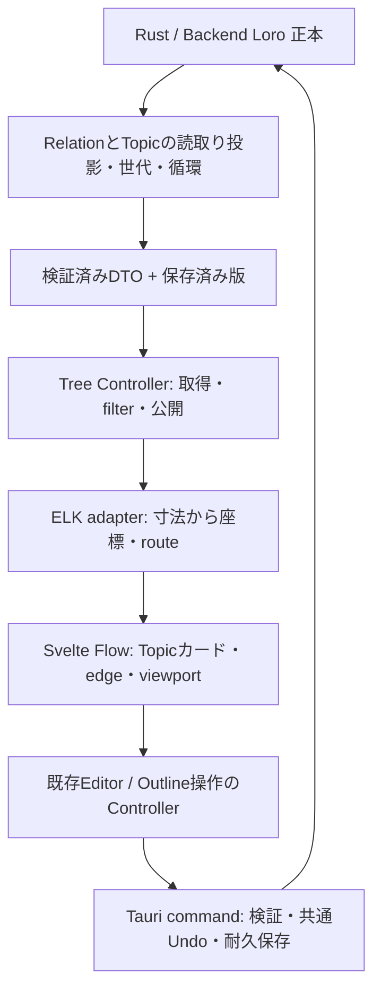

# 縦系譜ツリー：実装計画

作成日: 2026-10-30。状態: 実装提案。コード・依存の導入、製品UIの完成を意味しない。 照合基点: `v3` /
`671ab70c26e963248de50f638d8c06b1a493a23f` とGitHub Issue #381/#383/#385。
実装先はTauri版。現行Deno版への新機能追加やmainへのmergeは含めない。
2026-10-30に[全体計画](tauri-migration-plan.md)と[移行バックログ](tauri-loro-transition-backlog.md)へ接合した。
本書のV0〜V5はM0〜M5/T-00〜11に含まれるTree側の工程であり、別の移行critical pathを作らない。

詳細なライブラリ能力・ライセンス・一次資料は[調査ノート](vertical-tree-library-research.md)を参照する。
2026-10-30にRelation投影・foldのSQLite保存・共通Undo細則をユーザーが採用した。
この3契約の正本は[v3決定事項](v3-model-decisions.md)。以下に残る寸法/配置等の実装提案とは区別する。
まず固定fixtureで表示・編集操作・再配置を検証し、その後にv3の保存APIへ接続する。
[縦ツリーの表示モック](../../spikes/vertical-tree-mock/index.html)でカード内編集・開閉・pan/zoomと既存配色を確認できる。
これは固定4 Topicの独立HTMLであり、Svelte Flow/ELKや保存APIのV1技術検証とは区別する。
ユーザー確認（2026-10-30）: この縦表示をv2のGlobal Lineage画面の後継として、Tauri版で置き換える。
モックの画面構成・配色を方向性とし、既存の到達・選択・filter等の必要な操作は初回範囲と受入に照らして引き継ぐ。

## 1. 入力と優先順位

| 入力                                                                                                                                       | この計画での扱い                                                                                     |
| ------------------------------------------------------------------------------------------------------------------------------------------ | ---------------------------------------------------------------------------------------------------- |
| [参照チャット「縦ツリー設計検討」](chatgpt-conversation://6ae1ab30-480c-83e8-8c72-12d37ef270eb)と添付スケッチ                              | Topicカード内に階層、カード間にはRelation。複数親・複数root・循環を扱う                              |
| 今回のユーザー回答                                                                                                                         | **派生元を上、派生先を下**。保存されたRelationの向きは変更しない                                     |
| [v3決定事項](v3-model-decisions.md)                                                                                                        | 単一Backend LoroDoc、root Block＝Topic、UUIDv7、本文所有/参照項目、削除・共通Undoの製品契約          |
| [#381](https://github.com/asadaame5121/Radiora/issues/381)                                                                                 | 文書境界・ID・参照。Issue本文に古い未決が残る項目は、新しいv3決定文書と区別する                      |
| [UI所有](ui-state-ownership.md)・[Tree所有](tree-state-ownership.md)・[画面復帰](outline-screen-navigation.md)                             | draft/選択/非同期公開/復帰を維持。v2のentity名はv3へ機械的に移植しない                               |
| [Tauri全体計画](tauri-migration-plan.md)・[移行バックログ](tauri-loro-transition-backlog.md)・[Tree性能契約](tree-performance-contract.md) | M/V/T工程の依存・保存との合流・退出gateは全体計画/バックログ。旧SVG/D3優先・横世代軸との差は接合済み |

チャット内のLOD、自然高さ、自動再配置、Hoist、SCC処理の具体案は、相手の提案を含む。
以下では採用済みの製品契約と、この計画の推奨案を分ける。表示方針の変更は全体計画にも反映するが、実装・Issue完了やgate到達とは扱わない。
[旧Topic資料](topic-document-design.md)の「UUID・Doc単位は未決」を現在の未決として再採用しない。
このworktreeにADR
0003はなく、旧移行文書から参照されているだけである。ADR整合の全体判断は#382に残す。
[名前/検索契約](v3-naming-and-search-contract.md)と[初回F表](v3-first-release-scope.md)を適用する。
root/通常Blockの別名と参照項目の固有見出しを表示・移動へ接続し、V0〜V5の採用範囲は初回必須として受入を追跡する。

## 2. 実装する体験と初回範囲

- 一つのTopicを一つのカードに表示する。root
  Blockをタイトルとして編集し、子孫はアウトライン順に並べる。
- 内部Block一つずつをSvelte Flow nodeにしない。カード内の階層とカード間の系譜を別構造として保つ。
- 複数親のTopicもカードは一つ。Relationごとにedgeを持ち、カードを親の数だけ複製しない。
- カード内で本文・階層・折りたたみを操作する。root
  Enter、通常Blockの分割/改行、境界を越えないindent/outdentはv3契約に従う。
- 参照項目は代表本文の読取り専用表示と代表への移動を提供し、配置固有の子構造を維持する。
- pan/zoom、カード/Blockの選択、明示的な全体表示・選択へ移動、取得/保存/配置エラーと再試行を提供する。
- 通常削除・復元・完全削除・文書切り出し/移動は既存のv3
  commandを使う。未実装commandを画面で成功扱いしない。

初回の新規UIから、自由なカード座標の保存、handleのdragによるRelation作成、複数カードの同時編集、
ミニマップ、高度なLOD/cluster、系譜Hoist専用UIは後続へ分ける。初回も既存UIを適合したRelation編集は必須とし、handle接続編集は条件にしない。
カード内の編集は一度に一つのBlockをアクティブにし、他は軽い表示にする。
これは全カードが編集入口を持つ設計であり、読取り専用カードだけで完成とはしない。

**完了の区切り**:
固定fixtureの表示だけは技術PoC。本文編集・耐久保存・参照項目反映・再起動までが最初の製品slice。
アウトライナー操作と削除/移動/Undoの必要なcommandを接続し、規模・実WebView検証まで通して縦ツリーの完成とする。
#385に後続操作を一括追加せず、別sliceで追跡する。

## 3. 移植前に明文化する差分

### FROMの保存方向・表示方向・世代

現行実装は次の三つが一致していない。

- 保存の意味は `New FROM Old`、endpointは `New → Old`（[製品方向](product-direction.md) §5）。
- 描画はFROMだけ反転し、`Old → New`（[rawEdges](../../src/ui/tree_layout.ts)、[描画テスト](../../tests/tree_layout_test.ts)）。
- 現行の世代は保存方向を辿り、`New=G0, Old=G1`。その期待値を固定した[テスト](../../tests/tree_layout_test.ts)がある。

したがって、旧x/yの交換だけでは今回の上下を満たさない。
**新投影では「保存endpoint」と「世代を進める表示endpoint」を分ける。FROMは派生元→派生先を表示方向とし、派生元をG0側にする。**
custom Relationは`advancesGeneration`だけでなく向きを確認する。
初回案は「FROMは反転、その他の世代進行型は保存方向」。型ごとに逆向き指定を追加するschema拡張は、必要が判明するまで作らない。
旧テストを無言で書換えず、v2の期待値とv3で変える期待値を並べて記録する。

### Relation対象とTopicカードへの投影（採用契約）

Relation endpointはroot・通常Block・参照項目の論理Block IDとする。
参照項目のRelationはその項目に属し、本文ownerへ自動で付け替えない。
旧データ変換の全schema/ID写像は#384へ残す。

| 論点                          | 採用する扱い                                                       |
| ----------------------------- | ------------------------------------------------------------------ |
| Topicカード                   | root論理Block IDで識別                                             |
| 通常Block・参照項目のRelation | 元endpointを保持し、所属Topic rootへ表示投影                       |
| 移動/文書切り出し             | Relation ID/endpointを維持し、所属Topicと表示edgeだけ更新          |
| 同一Topic内のRelation         | カード内関係。外部の世代計算に使わず、カード上の自己edgeを作らない |
| 元Blockの自己loop/循環        | 関係を保持してカード内循環として識別。Topic投影上の循環と区別      |
| 多重Relation                  | カード間の集約edgeに元Relation ID集合と件数を保持                  |
| Missing/ゴミ箱                | 関係を保持し削除済み本文を表示しない。通常の世代計算から除外       |

世代/SCCは**表示filter適用前**の有効な世代進行Relationから計算する。
filterは表示対象だけを変え、世代番号と循環membershipを変えない。
これは初稿の「可視graphから再計算」案を置き換える採用契約であり、v2回帰と別に期待値を固定する。
Topic間投影の循環メンバーだけをKnotへ分離し、出入りする非循環Topicを巻き込まない。
旧`mergeImplicitFromLinks`は配置の親子からFROMを導出するため、そのままv3へ移植しない。LoroTreeのindentで系譜を増やさない。

### 循環は旧Knot契約を基準にする

反復Tarjanは[tree_lineage_cycles.ts](../../src/ui/tree_lineage_cycles.ts)に実在し、自己ループ・収束DAGの[直接テスト](../../tests/tree_lineage_cycles_test.ts)もある。
[現行投影](../../src/ui/tree_lineage_projection.ts)の「循環memberだけをKnotへ分け、残るDAGを最深親+1」は新投影でも維持する。
適用対象は採用契約のTopic間graphとし、カード内の循環とは区別する。
循環へ出入りする非循環TopicまでKnotにせず、元Relationは残す。
新UIでは通常の世代配置から循環Topicを外し、ラベル付きKnot領域に各カードを置く。
循環内・通常領域との接続edgeも、正規化した表示方向と元Relation
IDを維持して表示する。領域は描画上の区分であり、LoroTreeの親ではない。
ELKへ渡す通常配置グラフはDAGだが、画面に描くRelation全体は循環を含められる。
Knot領域内の初回配置はID順の非重複gridで足りる。SCCごとの縮約・折りたたみは後続候補。

ELKのcycle breakingだけに依存したり、SCC縮約後の世代を現行仕様と同じと見なしたりしない。
Rustへ移植する場合も、TS/Rustを製品で二重の意味ownerにせず、同じfixtureを用いて置換する。

## 4. 責務と状態所有

| 状態                                  | 正本・owner / writer                                | 寿命・保存・失効                                                                                                        |
| ------------------------------------- | --------------------------------------------------- | ----------------------------------------------------------------------------------------------------------------------- |
| Block本文・階層・Relation・論理ID     | Backend Loro / 業務command                          | SQLiteへ耐久化。UI node配列から書き戻さない                                                                             |
| 共通Undo/Redo                         | Backend共通manager                                  | workspace内の起動中履歴。再起動後は空にし、カード別manager/native editorと二重所有しない                                |
| 未保存本文・save status               | 既存Editor Controllerをv3 portへ適合                | App寿命。失敗/カードunmountで捨てず、保存成功versionを確認する                                                          |
| 可視Topic/Relation・filter・取得error | Tree Controller                                     | App寿命。データ版、filter key、要求世代で失効                                                                           |
| 世代・Knot membership                 | Backend読取り投影                                   | 保存済み版のfilter適用前の有効graphから導出。表示filterだけでは変えない。PoCのみ純粋TSを利用可                          |
| Svelte Flow nodes/edges・寸法・座標   | TreeのView用Controller/adapter                      | View寿命の描画cache。意味グラフの正本にしない                                                                           |
| pan/zoom・hover                       | Svelte Flowを操作するView                           | View寿命。独立D3 cameraと同時に管理しない                                                                               |
| アクティブなカード内Block・caret      | Editor/Tree編集文脈とDOM adapter                    | IDとselection方向を捕捉。全画面選択はWorkspaceへ操作として渡す                                                          |
| 本文階層のfold                        | UI設定Controllerの公開操作 / Backend設定APIで永続化 | ユーザーのworkspace共通設定。SQLiteの別設定領域へworkspace/Block IDで保存。各paneとOutline/カードで共有、再起動後も保持 |
| 対象を見せる一時展開                  | 各paneの表示Controller                              | pane寿命。保存済みfoldを変更しない                                                                                      |
| カードの内容開閉                      | Tree Controllerの公開操作 / Backend設定APIで永続化  | 本文foldと別keyでSQLite保存。系譜Hoistは初回対象外                                                                      |

既存の`TreeController.prepareRefresh`の要求scopeを再利用し、API/ELKに同じ公開規則を適用する。 Svelte
Flow内部の選択は描画用の写しとし、アプリの選択と双方向effectで同期しない。 カード内Block IDとTopic
root IDを分け、休止中のOutline pane位置をTree選択で上書きしない。
画面を跨ぐリンク・代表への移動は`ScreenNavigationWorkspace.navigate(destination, origin)`を通す。

組込みeditorのnative Undo経路はアプリ共通入口へ集約し、IME変換中はアプリUndoが介入しない。
未保存入力flushの失敗では履歴操作を行わず、autosaveだけではUndo単位を区切らない。
同じBlockへの入力間隔1秒以内、IME一変換確定、paste/cut一操作、構造変更一操作を区切りとし、
Block/caretの明示移動・別pane操作で直前のまとまりを終了する。
別pane/カードのUndoでは自動移動せず、対象通知と明示的な「対象へ移動」を出す。
現在のeditorが対象なら有効な操作前caretへ戻す。再起動後のUndo履歴は保持しない。 重いSvelte
ViewへI/Oやgraph計算を追加せず、既存Controller/adapterを必要な範囲だけ適合する。
新設ファイル名は実装時に現行構成へ合わせる。汎用graph frameworkや将来のengine切替層は作らない。

## 5. 可変高さ・編集・viewportの方針

### 寸法から配置する

1. 固定カード幅（PoC開始値360 CSS px、調整可能な製品設定にはしない）と自然高さで表示する。
2. Svelte
   Flowの未変換のnode寸法を受け取り、ELKへwidth/heightを渡す。`getBoundingClientRect`のzoom後寸法を二重適用しない。
3. 世代の順序を縦方向に保ち、portは上が派生元側、下が派生先側。FROMの意味は反転済みの表示endpointで表す。
4. ELK Layered + DOWNでDAGの座標とrouteを得る。ELKのrank番号をRadioraの世代値として採用しない。
   各世代進行edgeで派生先が下にあり、カードboundsが重ならないことを結果の検査に含める。
5. 初回はELKの座標とedge sectionsを保って描画する。Svelte Flow custom edgeへELKの経路を写す。
   Knot領域は通常DAGのbounds外に配置し、領域を跨ぐedgeとself-loopだけ別経路を与える。
6. カードサイズ変更はまとめて再配置要求にする。位置だけの変更で再測定→再配置をループさせない。
   微小な寸法変化は正規化して無視し、viewportのpan/zoomではELKを呼ばない。

同じ世代番号を持つカードを厳密に同じyへ揃えることは、今回の上下方向の決定とは別のUI要件。
必要な場合は世代制約を渡す方式をV1で検証する。ELK結果のyだけを上書きしてrouteを流用しない。
代替の世代帯配置では、各世代の最大高さだけでなく、カード幅を使った横方向の非重複配置も必要になる。
自前配置で十分なら不要なELK依存を残さない。初回から二つのlayout方式を製品設定にしない。
ELKを入れたという理由で、世代・Knot・非重複が保証されたと扱わない。

### 書いている位置を動かさない

- アクティブなeditorはBlock IDでkeyを固定し、node配列更新や再配置で作り直さない。
- 入力で高さが変わった際はobserverで最新寸法を捕捉し、frame単位で更新をまとめる。
  composition中は本文構造の変更を確定せず、キャンバス全体の再配置を保留し、composition終了後に要求する。
- 入力継続中は全体fitを行わない。アクティブカードを画面内の同じ位置へ保つよう、受理したlayout差分だけviewportへ補償する。
  明示的なpan/zoomが割り込んだ場合は古い補償を適用しない。初回の一時fitと「全体表示」は別操作にする。
- editor領域は`nodrag`/`nopan`、本文scroll領域は`nowheel`を適用する。
  Delete/Backspace、矢印、Enter/Tab、Ctrl/Cmd+A/Zがcanvasの削除・選択・移動へ漏れないことを検証する。
- 自由drag/接続/削除のSvelte Flow既定動作は初回無効。Relation削除は業務commandの既存経路を通す。
- 編集中/draft保持中カードはviewport外でも勝手にunmountさせない。
  `onlyRenderVisibleElements`は完成したeditor仮想化ではないため、最初は無効で検証する。

巨大Topicで自然高さが実用にならない場合は、内容領域を上限高さ+内部scrollにし、見えていない項目があることを示す案をV1で比較する。
カード内の長大アウトラインは既存の[仮想化契約](outline-virtualization-contract.md)を再評価する。
全文editorを各カード/各行に常時生成する実装は採らない。新しい仮想化libraryは計測前に追加しない。

### 非同期layoutの公開条件

`dataVersion + filterKey + displayMode + measurementRevision + layoutGeneration`を要求に捕捉する。
公開時に全ての一致とView生存を確認し、座標とedgeを一緒に更新する。
古い成功・error・finallyで最新のlayout/loadingを書き換えない。
一つのlayout実行中は最新のpending入力だけを残し、入力ごとに古い計算queueを積み増さない。
通常のpan/zoomはlayout keyに含めず、viewport補償にだけ別の操作世代を使う。
unmount/disposeでは公開権限、timer、observer、listener、専用Workerを解放する。
ELK失敗時は有効な旧配置と再試行を示し、初回失敗を空グラフ成功にしない。
古い結果の破棄と計算の中断は別であり、Workerの中断APIがあると仮定しない。

## 6. ライブラリ選定

| 依存                        | 推奨                                  | 理由・範囲                                                                                       |
| --------------------------- | ------------------------------------- | ------------------------------------------------------------------------------------------------ |
| `@xyflow/svelte`            | 新規採用予定                          | Svelte 5 custom node、edge、pan/zoom、選択・keyboard基盤。本文編集・系譜意味・自動layoutは別責務 |
| `elkjs`                     | 新規採用の第一候補                    | 複数親DAG、可変node寸法、Layered配置。Workerへ計算を分離できる。Tauri配布asset/CSPをV1で確認     |
| `@dagrejs/dagre`            | 初回は追加しない                      | より単純な代替。ELKがbundle/Worker要件で不適合の場合だけ同じfixtureで比較                        |
| 既存OverType/editor adapter | 再利用                                | 日本語・Markdown・selectionの既存経路を適合。Tiptap/CodeMirror等への同時乗換えは不要             |
| 既存Valibot                 | 再利用                                | IPC/WorkerのDTO、数値・ID・欠損等のruntime validation                                            |
| 既存fast-check              | 再利用                                | 循環・DAG化・入力順独立・参照保持のPBT。固定seed/縮小反例を保存                                  |
| 既存Vitest/Playwright/axe   | 再利用                                | Controllerの応答逆順、DOM/focus、keyboard/a11y、browser回帰。実WebView試験は別途必要             |
| `petgraph`（Rust）          | Backendの構造計算を実装する段階で判断 | 旧移行計画の候補。PoCにTS/Rustの二重実装を同時追加しない。内部indexを永続IDにしない              |

新規frontend
runtime依存はまず二つに絞る。独自のpan/zoom、D3とFlowの二重操作層、graphology、D3階層layout、専用DAG
widgetを重ねない。 exact version・transitive
license・Workerのbundle内取込みをV1で固定し、既存の依存管理方式に合わせてlockを更新する。
本調査時のversionを無条件で将来のlatest扱いしない。MITのSvelte
FlowとELKのlicense条件は調査ノートを参照する。 既存D3の削除は他画面の利用を調べた後の別作業とする。

Rust候補のpetgraph `tarjan_scc`は再帰実装であり、既存の反復Tarjanと深さ耐性が同じではない。
移植では深い鎖/巨大SCCのfixtureを必須にし、反復Tarjanを維持するか、算法変更を別途判断する。
詳細は[調査ノートのRust候補](vertical-tree-library-research.md#rustへ構造計算を移す場合の任意候補)を参照する。

## 7. 実装順序とPRの区切り

M工程との対応・依存グラフは[全体計画 §7.2](tauri-migration-plan.md#72-縦treeと移行工程の接合)、
Issue順と退出gateは[バックログ §4](tauri-loro-transition-backlog.md#4-実行順契約と検証をslice単位で進める)を参照する。

| 段階                  | 統合工程                         | 到達点・変更対象                                                                       | 前提                                                                           | 受入/終了条件                                                                                     |
| --------------------- | -------------------------------- | -------------------------------------------------------------------------------------- | ------------------------------------------------------------------------------ | ------------------------------------------------------------------------------------------------- |
| V0 契約fixture        | M0 / T-00・T-03                  | 採用済みRelation/方向/filter前SCC・SQLite fold・Undo細則をv3 fixtureへ固定             | 仕様は決定済み。schema/DTOの具体化と保存PoCは並行可                            | 元endpoint、filterで不変の世代、カード内/Topic循環、foldと文書の分離を証明                        |
| V1 表示・操作PoC      | M1 mock shell・M3 / T-08技術検証 | Svelte Flow custom node + ELK、固定fixture、可変高さ、IME/keyboard                     | V0。静的browser試験はshell前でも可。実WebView試験にはM1 mock shellが必要       | 複数親/循環/日本語/空カード/高さ変化。focusを保持しTauri Workerが起動。保存/Importer合格とは別    |
| V2 v3読取り接続       | M1読取り・M2・M3 / T-08          | RustのTopic/Relation投影、DTO、Tree Controller、filter/選択/画面遷移                   | Tauri基盤、#381の対象契約、#383の保存済みread model。製品受入に#384対象fixture | 保存済み版だけ描画し旧要求を破棄。Missing/ゴミ箱、移動後edge、TS/Rustの単一owner                  |
| V3 カード本文編集     | M4 / T-06成果をT-08へ接続        | #385のEditor draft/OverType/DTO/保存をカードから再利用。参照項目、再起動、共通Undo接続 | V2とT-06/#385の本文保存成果。#385自体は縦Tree完成を待たない                    | 日本語編集→耐久保存→参照項目→再起動。失敗/retry/旧応答/caretを実WebViewで確認。writerを増やさない |
| V4 アウトライナー操作 | M4 / T-07                        | 分割/改行、indent/outdent、切り出し/移動、削除復元・purge UIへ既存commandを接続        | V3の編集接合とT-07/#286等の操作command/契約                                    | ID/本文/順序/Relation、共通Undo/Redo一操作単位、purge後clear、編集位置。#385に全操作を追加しない  |
| V5 規模・利用検証     | M5 / T-09                        | 長文/高密度、描画削減、a11y、配布build、計測                                           | V3/V4、初回F表、対象端末/表示規模を固定                                        | 性能・Worker/CSP・実WebViewの統合受入。TreeのF09と全Fの証拠をT-10/G2へ渡す                        |

V0/V1はT-04の保存PoC/Importerと並行する技術検証であり、#385の#383/#384依存を解除しない。
最初の製品保存sliceはT-06/#385として独立に証明し、その成果をV3でカードへ接続する。
V4のcommandはT-07、Tree固有の表示/接合はT-08、V5の統合受入はT-09が所有し、同じ実装を二重に数えない。
個別Issueは既存との重複を照合して必要時に切る。本接合ではIssue作成・本文変更・close・Project更新を行っていない。

着手時はfixture→表示→読取り→既存保存経路との接合→個別構造操作へPRを分ける。
業務計算のRust移植と可変カードUIのデバッグを同じ差分に混ぜない。
Chronology/歴史年代の時間軸はELKで上書きしない。旧Treeの全面削除はこの計画の前提ではない。

## 8. 必須の検証と性能判断

### 固定fixtureとPBT

- 空/同名/子なしTopic、深い内部階層、長い日本語、emoji/結合文字/CRLF、巨大本文。
- 派生元→複数派生先、複数root、複数親のdiamond、非連結、自己循環、複数SCC、循環への流入/流出。
- custom世代進行型、非世代進行型、撤回、Missing、同一Topic内Relation、同じカード間の複数Relation。
- Relation追加/削除/撤回、型設定変更、本文変更、Block切り出し/移動、削除/復元で投影が更新される。
- 参照項目の子構造と代表本文を分離し、削除済み本文をpreview/cacheへ戻さない。
- API/ELKの応答逆順、dispose後完了、旧error/finally、保存失敗/retry、切替中の編集と共通Undo。
- fold/カード開閉のSQLite再起動保持、各pane共有、一時展開だけの解除、設定保存失敗。
- 入力/IME/別paneによるUndo区切り、autosaveとの独立、対象通知と明示移動、再起動後の空履歴。

性質は独立した単純oracleと比較する。Tarjanをそのままテスト側へ複写しない。

1. 元Block/Relation入力と保存endpointを変更しない。
2. 通常layout入力はDAG。循環メンバーだけがKnot、非循環の子孫を巻き込まない。
3. DAG入力では対象Relationを失わず、全ての世代進行edgeで下側の世代が大きい。
4. 元Relationは通常配置/Knot接続/カード内/除外理由のいずれかへ追跡できる。
   表示filterだけを変えても同じTopicの世代と循環membershipは変わらない。
5. 同じ入力と寸法で決定的。node/edge入力順を変えても同じ意味と安定した配置になる。
6. 有限な座標・非重複bounds・安定ID。pan/通常zoomでlayout実行回数が増えない。

3は**正規化した表示方向**に対する新仕様の検査。旧世代方向を維持するテストとは区別する。 layout
pixel座標のsnapshotだけで、意味・参照・編集の受入を代用しない。

### ブラウザ・実WebView

カード内の選択drag、IME確定Enter、Tab、矢印、Delete、Undo、scrollとcanvas操作の分離を確認する。
pan中のunmount、filterで編集中カードが消える場合、再配置中の次の入力、画面遷移後の古いfocus復帰も試す。
editorをfilterで隠す前にはdraft保存/保持のguardを通し、失敗なら編集文脈を残す。
拡大縮小時の文字可読性、keyboardだけでのカード/行移動、空グラフのfocus、エラー通知を検証する。
Playwright結果だけでWindows WebView2のIMEやTauri Workerが合格したとしない。

### 規模と仮の目標

保存Docの総Block数、表示対象Topic数、カード内可視行数、同時editor数を別々に数える。
#383の「1万Block」の成功を「1万個の編集カードを全てDOMへ置ける」根拠にしない。

fixtureは小規模20〜50 Topicから、300/1,000 Topic、表示対象10,000 Topicの限界確認へ拡張する。
深い鎖、高分岐hub、diamond、長文カード、大小混在、循環を別系列にする。
上限に達したら範囲制限/折りたたみ/previewの内容を明示し、黙ってデータを欠落させない。
ズームによるLOD切替でサイズ→layout→zoomの循環を作らず、編集カードの寸法とDOMを維持する。

同端末・release build・固定seedでp50/p95、失敗/timeoutを記録する。 計測対象は投影、IPC
bytes、Worker転送、ELK、DOM/paint、input→paint、保存完了、frame、heap、editor数、再配置回数。
初期layoutと通常入力を分ける。初期配置はplaceholder/状態表示を含めて待ち時間を測る。

V1の仮目標は入力→paint p95 < 50ms、pan/zoomは対象端末のframe budget内、可視カードの重なりなし。
初期/再layoutの正式上限はV1の端末/fixture測定後に固定する。
未達なら可視範囲・DOM数・再配置頻度を先に調べ、engine切替や高度なLODを自動追加しない。
layoutが高速でもIMEやdraftが失われれば不合格。

## 9. 今回確認した範囲と残作業

参照チャット全3 turnと添付図、GitHub
#381/#383/#385、ローカルv3設計文書、循環/世代/edge方向のコードと既存テストを照合した。
反復TarjanとKnot処理の実在は静的確認できた。旧世代と描画の方向差は既存テストに明示されている。
これはv3のRelation投影・新UIが実装済みであるという証拠ではない。

初稿時に既存3ファイルのDeno testを試したが、mise
shimの起動待ちとcacheアクセス拒否で中断した。合否証拠はない。
今回の全体計画への接合は文書だけの変更であり、runtime test・依存導入・DB変換は行っていない。
文書間の参照・M/V/T対応・旧方針との矛盾・Git差分を検査し、GitHub Issue/Projectのlive更新は行わない。

次の着手はT-00/T-03のV0契約fixtureとT-04の保存PoC、M1 mock shell/V1を並行できる。
Relation投影・SQLite
fold保存・Undo細則は採用済みであり、V0で期待結果を固定する。巨大カードの高さ制限は引き続き実装/実機検証で判断する。

2026-10-30に独立HTMLモックを追加した。JavaScript構文・fixtureのID/世代方向・既存色tokenの参照を検査した。
ブラウザ自動表示はツールのfile URL制限で未実施。IME・描画・操作感は手動確認と実WebView検証が必要。
